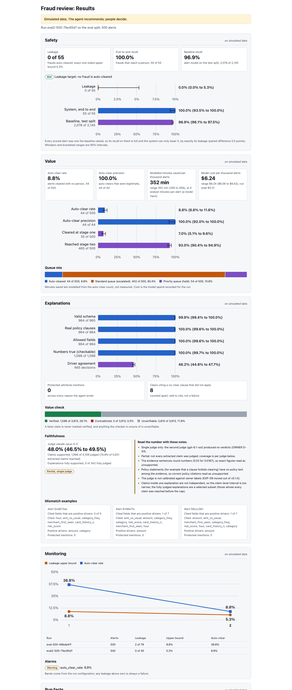
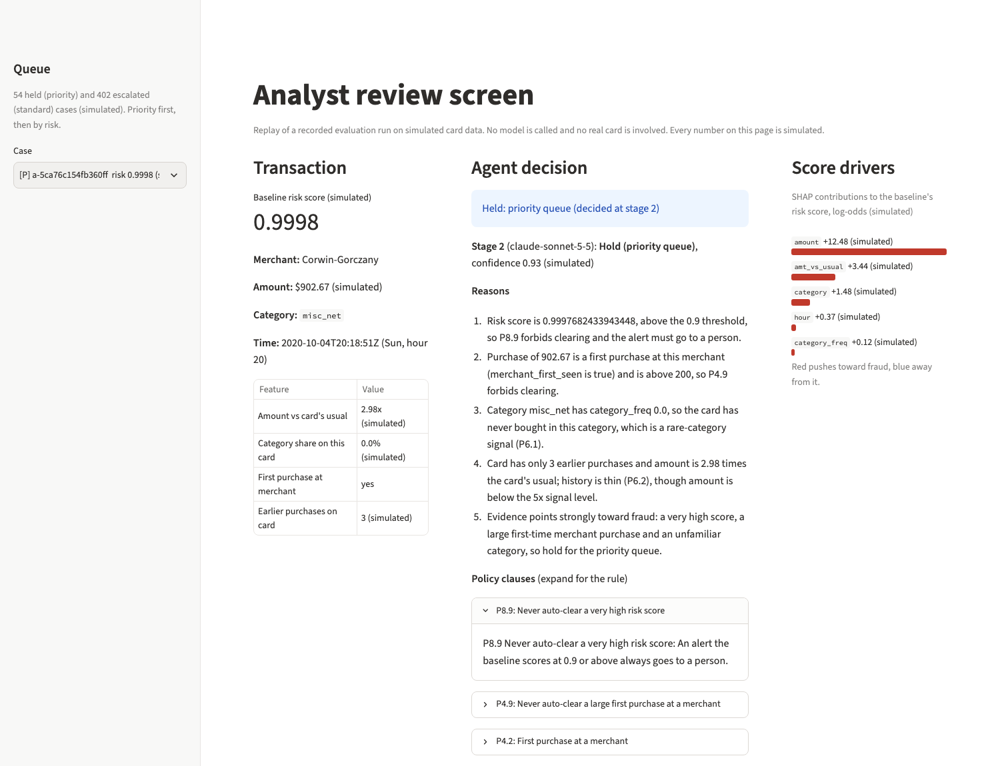
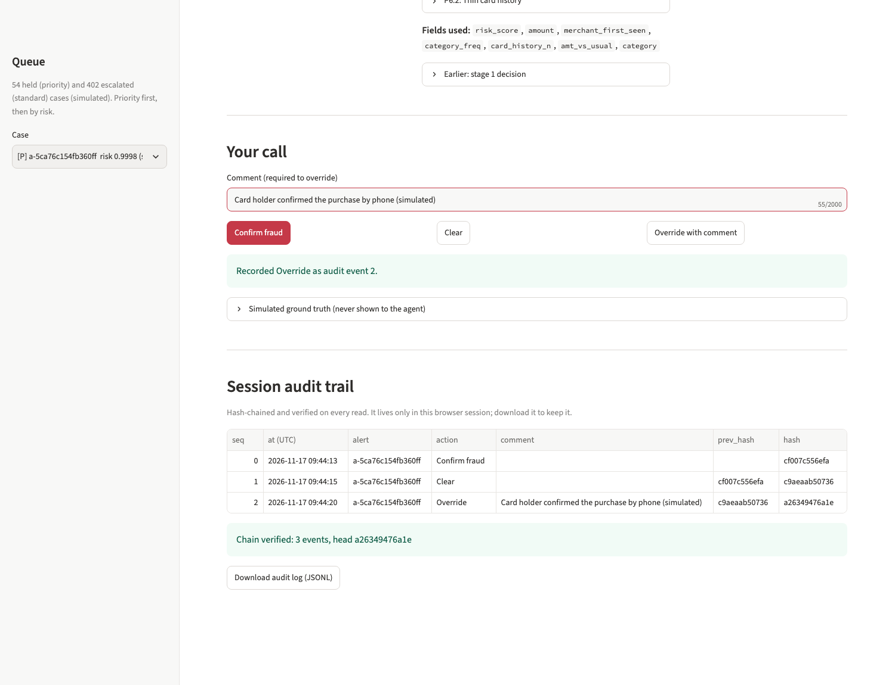
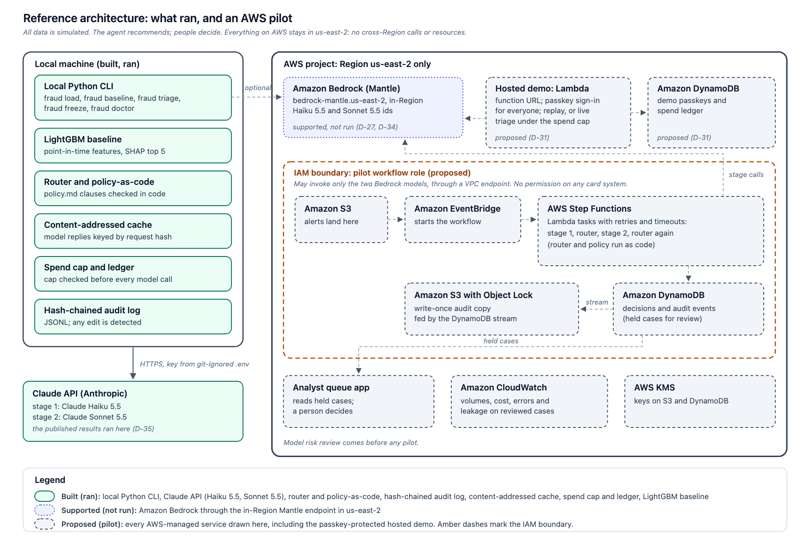

# fraud-review-bedrock

A fraud-review agent for card alerts. It reads each alert, clears only what a written policy allows, and sends everything else to a person with its reasons beside the evidence. It has no tool that can block a card or contact a customer, and every step is written to a hash-chained audit log. It runs on Claude through the Claude API or Amazon Bedrock, and all the data is simulated.

Two Claude models do the reading: a small one screens each alert and a larger one reviews what the first will not clear. A rule written in code, not the model, decides whether a clear is allowed.

## The result (simulated data)

The safety bar is that the agent auto-clears no fraud.

- **The first frozen run failed.** It leaked 2 of 79 frauds (simulated data). That run stays in the record.
- One policy change followed: never auto-clear a purchase made at night. It was chosen on a separate 100-alert development set, not on the run that failed.
- **On a fresh set of 500 alerts the bar held.** The agent auto-cleared 0 of 55 frauds. The exact 95% upper bound is 5.3% (simulated data), so 55 frauds is a small sample.
- It auto-cleared 8.8% of alerts (44 of 500, simulated data), and all 44 were legitimate. The night rule cost automation: the rate was 36.8% before it (simulated data).
- Model spend was about $6.24 per 1,000 alerts (simulated data).
- The reasons are checkable in part. All 1,098 checkable numbers in them were true (simulated data). The faithfulness check is a single-judge partial result, with 48.0% of judged claims supported, and it is not calibrated (simulated data).

This is a demonstration. It is not validated for real use. Read the [case study](docs/case-study.md) and the [PR/FAQ](docs/pr-faq.md) for the limits.









## Quickstart

You need Python 3.12 and [uv](https://docs.astral.sh/uv/). Steps 1 to 4 need no key and make no model call.

### 1. Install

```bash
git clone https://github.com/biplob819/fraud-review-bedrock
cd fraud-review-bedrock
uv sync --locked
```

### 2. See it work with no keys

Render the results dashboard from the committed example run. This reads no key and reaches no network. It writes `report.html`, which you open in a browser.

```bash
uv run fraud report --example
```

Then run the replay demo of the analyst screen. It replays recorded cases and calls no model.

```bash
uv sync --locked --extra demo
uv run streamlit run demo/app.py
```

### 3. Check your setup

```bash
uv run fraud doctor --offline
```

This checks Python, the run config, the prices and the credentials you have, without the network. It never prints a secret. Run `uv run fraud doctor` without `--offline` once you have set a key or a profile, to check the provider and the models.

### 4. Estimate before you spend

```bash
uv run fraud triage --split dev --alerts 100 --dry-run
```

A dry run makes no call. It prints the calls and the estimated cost, then stops. The spend cap is the `max_cost_usd` value in `config.yaml` (there is no flag for it). A run whose estimate is over the cap will not start, and a run that reaches the cap stops and can be resumed. See [Control cost](docs/guide/cost.md).

### 5. Run with your own Claude API key

```bash
cp .env.example .env     # then put your key in ANTHROPIC_API_KEY; never commit .env
uv run fraud doctor
uv run fraud load        # downloads the simulated source data; needs a Kaggle token
uv run fraud baseline    # builds the alert samples
uv run fraud triage --split dev --alerts 20
```

Start with a small number of alerts. To use your own alerts instead of `fraud load` and `fraud baseline`, see [Bring your own alert data](docs/guide/own-data.md). To use your own rules, see [Write your own policy](docs/guide/policy.md).

### 6. Run on Amazon Bedrock

Bedrock is supported through the in-Region Mantle endpoint. It was not run for the published results, which used the Claude API, so treat this path as untested here.

1. In `config.yaml`, set `provider: bedrock`, set `region` to a Region where you have model access, and use the Bedrock model ids (for example `anthropic.claude-haiku-5-5` and `anthropic.claude-sonnet-5-5`).
2. Sign in with your AWS profile, for example `export AWS_PROFILE=<your profile>`. No key goes in the project.
3. Run `uv run fraud doctor`, then `uv run fraud triage --split dev --alerts 20 --dry-run`, then the same command without `--dry-run`.

`prices.yaml` has a table for each provider. Check the Bedrock prices before you rely on the estimate.

## Guides

- [Write your own policy](docs/guide/policy.md)
- [Bring your own alert data](docs/guide/own-data.md)
- [Control cost](docs/guide/cost.md): the dry run, the cap and the ledger
- [Privacy](docs/guide/privacy.md): no telemetry; data goes only to the provider you configure

## Links

- [Results dashboard](docs/dashboard.html): one self-contained page. Open the file in a browser. A workflow that publishes it to GitHub Pages is in the repo and is switched on by the owner when wanted.
- [Replay demo](demo/README.md): the analyst review screen, run locally.
- [Case study](docs/case-study.md)
- [PR/FAQ](docs/pr-faq.md)
- [ROI model](docs/roi/README.md): a workbook with inputs you change. Its defaults are illustrative.
- [Discovery summary](docs/discovery-summary.md)
- [Reusable patterns](docs/patterns.md)
- [Architecture](docs/assets/architecture.png) ([SVG](docs/assets/architecture.svg), [data flow](docs/assets/dataflow.svg))
- [Data card](DATA_CARD.md)
- [Decision log](docs/decisions.md)
- [PRD](PRD.md)
- [Tech Spec](TECH_SPEC.md)
- [Spend ledger](docs/measurements/spend-ledger.jsonl): what every real run cost
- [Changelog](changelog.md) and [versioning](docs/versioning.md)

## What is planned, and what is not

- A hosted demo is planned for v0.2. In this release the demo runs only on your machine.
- There is no video.
- The package is not on PyPI. Releases attach a wheel and a source archive on GitHub.

## Data and credits

All data is simulated. See [NOTICE](NOTICE) for the Sparkov simulator and Amazon's Fraud Dataset Benchmark, and [DATA_CARD.md](DATA_CARD.md) for how the data is loaded. No data file is committed; you download it yourself with `fraud load`.

## Contributing and security

See [CONTRIBUTING.md](CONTRIBUTING.md), [SECURITY.md](SECURITY.md) and the [Code of Conduct](CODE_OF_CONDUCT.md). To work on the build itself, `uv run python scripts/status.py` shows where each part stands.

## Licence

MIT. See [LICENSE](LICENSE).
