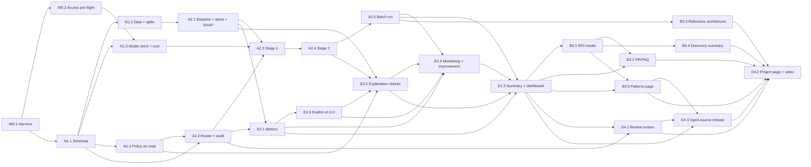

# fraud-review-bedrock Tech Spec

@Biplob Chakraborty · Companion to the [PRD](PRD.md)

The PRD says what the pack does and why. This spec says how it is built: the runtime pipeline, schemas, the policy-as-code format, the router that keeps the agent from acting on its own, evaluation and statistics, the cost model, testing, and the build harness that delivers it node by node. It follows the method used for EvalKit ([EvalKit](https://github.com/biplob819/evalkit) Tech Spec §11): a loophole review of the PRD first, then design decisions, then a dependency-gated build graph with a capability catalog, self-tested gates and a skeptical verifier.

Owner rulings are marked `OWNER D-n`. Appendix A lists every loophole found in the PRD and what closes it; Appendix B lists the PRD edits this spec proposes.

---

## 1. Design decisions

Each decision below seeds `docs/decisions.md` as D-1 to D-29.

| ID | Decision | Alternatives considered | Why |
| --- | --- | --- | --- |
| D-1 | The pipeline is a typed graph of steps with a content-addressed response cache, written in this repo (about 200 lines) | Import EvalKit's runtime; no cache, plain JSONL | EvalKit's runtime is not in its public API (`evalkit.scorers`, `schemas`, `compare`). One cache gives resume, free reruns, the golden replay test and the demo replay file |
| D-2 | Claude on Bedrock through the anthropic SDK's `AnthropicBedrockMantle` client. Model IDs and inference profiles live in `config.yaml` and are verified in W0.2 | Legacy `AnthropicBedrock` (InvokeModel); boto3 Converse | Mantle is the current Messages-API path on Bedrock. Same request shape as the first-party API, so prompts and parsing are portable |
| D-3 | Structured output through `output_config.format` (`messages.parse` with the pydantic model) | Forced `tool_choice`; free-text JSON | Forced tool choice returns a 400 on Sonnet 5.5. Structured outputs are supported on Bedrock and guarantee a schema-valid reply |
| D-4 | The agent has no tools. It returns a decision record and nothing else | An agent with tools that act | B6 holds by construction: no block or contact tool exists to call. A test asserts the request carries no `tools` |
| D-5 | A deterministic router decides the final disposition. A model's "clear" is a proposal that the router accepts only when a cited clearing clause's predicate is true in code | Trust the model's action and confidence | Closes C5. B4 becomes a code check, not a model's opinion. Self-reported confidence is recorded but never the only gate |
| D-6 | Policy as code: `policy.md` holds numbered clauses in prose plus a fenced YAML block per clause with `kind` (signal, clear, no_clear), `fields` and a `when` predicate over allow-listed features. The first 16 hex characters of its sha256 are `policy_version` | Prose policy only | Makes B4 and B8 checkable, gives the "policy-as-code format" reusable pattern, and versions every decision |
| D-7 | Prompts are built from a field **allow-list**. SHAP drivers and the fraud label never reach a prompt; they live in a separate type (`AlertTruth`) that agent modules cannot import | Deny-list of PII columns; one `Alert` object | Closes H4, H5 and the circularity in C3. B7 holds by construction because protected attributes are never sent |
| D-8 | Time-based splits. FDB's train file splits into train and validation by date; FDB's test file is the test period. Prompt and policy tuning use a **dev set** of 100 alerts from the validation period. Reported numbers come from an **eval set** of 500 alerts from the test period. Policy and prompts are frozen (hashed) before the eval run | Tune and report on the same 500 alerts | Closes C2. A reported auto-clear rate must not be training accuracy |
| D-9 | The alert threshold is set on validation so the baseline catches at least 98% of fraud, and the resulting alert precision is reported. If more than half of alerts are fraud, the threshold is lowered until the queue is mostly false positives, and the choice is logged | Default 0.5 threshold; tune for F1 | Closes C4. The PRD's problem is a queue of mostly legitimate alerts; a precision-tuned threshold on easy simulated data would leave nothing to clear |
| OWNER D-10 | The safety bar is **fraud leakage**: frauds auto-cleared ÷ frauds in the eval alerts. Target zero, reported with its exact 95% upper bound. End-to-end recall is reported next to the baseline's. Exit code 1 if leakage > 0 | Keep "recall at or above baseline"; allow a 1-point drop | Closes C1. The agent sits after the baseline, so it can only lower recall; "at or above" can only mean zero frauds cleared, so say that and measure it with an honest bound |
| OWNER D-11 | Explanation checks split in two. **Groundedness**: every cited clause exists, every cited field exists, and every reason's claim about a value is true (deterministic checks, then EvalKit's `faithfulness` scorer with both judges). **Driver agreement**: overlap between `fields_used` and the positive SHAP drivers. EvalKit judging runs offline on direct Anthropic and OpenAI keys | Only SHAP overlap, called faithfulness; a Bedrock adapter plugin with one judge | Closes C3 and P7. Quality first: two calibrated judges, labelled as an evaluation step outside the pilot boundary |
| D-12 | The audit log is append-only JSONL events (`decision`, `disposition`, `analyst_action`), each carrying the previous event's hash | Mutable `AuditEntry` rows | Closes H3. An analyst action later never rewrites history, and tampering is detectable |
| D-13 | Built with the node-graph build harness ported from EvalKit: `harness_lib.py`, `verify_graph_eligibility.py`, `node_start.py`, `node_converge.py`, `status.py`, `secret_scan.py`, with the gate list adapted (§11.6) | Rewrite the harness; tests only | The scripts and their self-tests are already proven. Porting is quick; rewriting would add work with no gain |
| D-14 | `results/<run_id>/summary.json` is the only source of numbers. The dashboard, ROI defaults, PR/FAQ, README and project page read from it, and the honesty gate checks every published number against it with the "on simulated data" label | Numbers typed into each artifact | Closes E9 and P3. A number changed in one place cannot drift from the others |
| D-15 | The demo is replay-only from a committed `demo/replay.jsonl`, holds no cloud credentials, and keeps analyst actions in a per-session log the visitor can download | Live mode; a shared log file | Closes E8. Streamlit Community Cloud storage is shared and wiped on restart; with no credentials there is nothing to leak or spend |
| D-16 | Stage 1 runs Claude Haiku 5.5 at effort `medium`; stage 2 runs Claude Sonnet 5.5 at effort `high`; adaptive thinking on both; no sampling parameters. Changes are measured on the dev set and logged | Lower effort to save cost | Quality first. Sonnet 5.5 rejects non-default sampling values, so determinism comes from the cache, not temperature |
| OWNER D-17 | No calendar. The build starts now and follows the dependency order in §11.3; this spec carries no dates or time slots | A single fixed build day; offline nodes on set weekdays | Closes P4. Progress is gated by green dependencies, not by the clock |
| D-18 | Repo `fraud-review-bedrock`, public on GitHub, Python 3.12 with uv, hatchling, src layout, package `fraudreview`, CLI `fraud`. The PRD and this spec live in the repo | Keep the design docs outside the repo | The repo is a deliverable; docs and code change together |
| D-19 | Uncertainty: Wilson 95% intervals for rates, exact (Clopper–Pearson) upper bound when the count is zero, bootstrap over alerts (10,000 resamples, seeded) for cost and minutes | Point estimates | Closes H7. 500 alerts is a small sample and a fraud lead will ask how sure we are |
| D-20 | Fail safe: an invalid reply after one retry, a refusal, or a transport failure after backoff escalates the alert to a person and is counted by type | Retry indefinitely; drop the alert | Closes E3. A system failure must never clear an alert |
| OWNER D-21 | The results dashboard is deployed to GitHub Pages from the public repo by a workflow | Cloudflare Pages, as the PRD says | Same as EvalKit (its D-47); free for a public repo and no extra account |
| OWNER D-22 | The repo is public on GitHub from W0.1 and every green node is pushed | Private until release; local commits only | The repo is a deliverable; CI runs from the first push. History is audited for secrets before each push |
| OWNER D-23 | The public PRD covers the product only; notes that are not about the product stay out of the repo | Include planning notes in the PRD | The repo is read by people evaluating the product |
| D-24 | Gate 8 is the honesty gate (`scripts/honesty_check.py`), replacing EvalKit's judge gate; gate 12 is EvalKit's records gate (changelog entry, criteria naming every row, `RUN-STATE.md`) | Keep a judge gate; a docs-freshness gate | There is no judge regression set here; an unlabelled published number is this project's equivalent risk. The ported records gate is already proven |
| D-25 | Repository operations run as the maintainer account `biplob819`, set per command, so no global `gh` state changes | Configure credentials globally | Same account as EvalKit; no side effects outside the repo |
| OWNER D-26 | Released as an open-source project: MIT licence, community files, a quickstart that works with the user's own keys and a replay mode that needs none, semver releases tagged on GitHub (node D4.3) | A code dump with no release process | Others can run it on their own data and providers; the repo is a reusable asset, not a one-off |
| D-27 | `provider: bedrock` or `anthropic` in `config.yaml`. Both use the anthropic SDK's Messages request shape (Mantle client or first-party client); Bedrock was the default and the published results were to run on it (superseded by D-35: they run on the Claude API); the provider is recorded on every decision and in `summary.json` | Bedrock only | Open-source users without Bedrock access can still run the agent; one switch, same prompts, same parsing |
| OWNER D-28 | The public repo uses neutral product framing: docs named `PRD.md` and `TECH_SPEC.md`, the demo described as a hosted replay, the write-up as a project page, the build harness credited to EvalKit | Longer descriptive file names | The repo is an open-source product; its docs describe the product |
| D-29 | Gate 3 runs every proof test with pytest and requires PASSED, on top of the static check | Static `ast` check only | Module and class marks, `importorskip`, `__test__ = False` and collection rules are invisible to a static check (verifier pass 2) |
| D-30 | `fraud load` downloads the Kaggle files FDB's `sparknov` key uses (`kartik2112/fraud-detection`) directly, pins both by sha256, keeps the original timestamps, cuts validation at the first day of the simulated 2020, and records each split's content hash in `splits.json` and in the committed `docs/data/splits.json`. Ids use a public HMAC key | Install the FDB package and use its processed frames | FDB pins old dependencies and shifts every timestamp by 20 months (cosmetic). The same files, pinned, give the same rows with fewer moving parts. The source is public, so a secret key would hide nothing; real data would use a key manager (DATA_CARD.md) |
| OWNER D-31 | The hosted demo requires a passkey (WebAuthn) for everyone. Signed-in users either enter the owner's passcode, which runs live triage on the owner's Bedrock account under a spend cap, or bring their own Anthropic API key, held only for the browser session and never stored or logged. It is hosted as a small serverless app in the owner's AWS project (us-east-2): a Lambda function URL, with DynamoDB holding passkeys and the spend ledger. Replay stays available to signed-in users with no key | D-15 replay-only demo with no sign-in; Streamlit Community Cloud | Owner ruling. Supersedes D-15's no-credential rule for the live mode only. The passcode and owner credentials stay server-side, and the spend cap is enforced before each call |
| OWNER D-32 | The release README has screenshots, a step-by-step guide (replay, own keys, Bedrock), and links to every important artifact: dashboard, demo, PRD, Tech Spec, data card, decision log, project page and video | A short README | Owner ruling |
| OWNER D-33 | Model calls run on Bedrock behind an AWS spend limit on the owner's project, about $10. Any single run estimated above $5 needs the owner's approval first, and `config.yaml` sets `max_cost_usd: 5`, so a run stops before it can exceed that. Cache replays, recorded replies and the 100-alert dev set come before any repeat run | No cap below the $25 approval line | Owner ruling: keep spend close to zero and in the owner's control. Prices from the Bedrock rate card: Haiku 5.5 $0.11/$0.55 and Sonnet 5.5 $2.20/$11 per million input/output tokens in-Region |
| D-34 | Bedrock is called through the Mantle endpoint in the project's own Region, `bedrock-mantle.us-east-2`, with in-Region model ids (`anthropic.claude-haiku-5-5`, `anthropic.claude-sonnet-5-5`). There is no cross-Region inference profile | `us.` or `global.` inference profiles in us-east-1 | The owner's AWS project allows no cross-Region calls or resources outside its Region (quotas for cross-Region profiles are 0). In-Region costs 10% more than global, a few cents at this scale. `aws login` credentials need `botocore[crt]` |
| D-35 | OWNER: the published results run on the Claude API (`provider: anthropic`, model ids `claude-haiku-5-5` and `claude-sonnet-5-5`) with the owner's API key, read from the git-ignored `.env` and never printed. Bedrock stays a supported provider with the same prompts and parsing (D-27, D-34); `prices.yaml` holds one price table per provider. On the Claude API, W0.2's proof is a free model listing for access, the `anthropic-ratelimit-*` response headers for limits, and one structured call and one cache pair per model | Wait for Bedrock access on the owner's AWS project | The AWS project could not get Claude enabled (free plan, use-case form refused), which blocked every node that calls a model. The request shape is the same on both providers, so the switch is one config line, and Claude API list prices are about 10% below Bedrock in-Region |
| D-36 | OWNER: the evaluation uses more of EvalKit than `faithfulness`: our checks registered as EvalKit scorers, two judges from different families (Claude and GPT), the `attack_outcome` prompt-injection probe, judge calibration on owner-labelled claims, and EvalKit's paired bootstrap with Holm correction for every variant comparison. A new node E2.4 adds monitoring (run history, alarm bands, a drift check, a trend panel) and a logged improvement loop on the dev set | Only `faithfulness` from EvalKit; tuning by eye without a ledger | The owner asked for EvalKit's capabilities, metrics, monitoring and improvement. Each change must be shown to help with honest statistics, and a deployment needs signals that say when it stops working |
| D-37 | OWNER: the alert set is approved as built in A2.1: threshold 0.003396 (98.0% validation recall, not lowered), a 100-alert dev sample with 21 frauds and a 500-alert eval sample with 79 frauds | A higher threshold with fewer, riskier alerts; a larger eval sample | The owner's sign-off before stage 1, as §11.3 requires. The eval sample's fraud count sets the zero-leak bound at about 3.7% |
| D-38 | OWNER: evaluations stay relevant to the project, and EvalKit grows with it. Three capabilities move into EvalKit v0.3.0 and this project pins that release: a rule-compliance scorer (cited rule ids exist and their machine-checked conditions hold), structured-evidence faithfulness (tabular input rendered as numbered evidence sentences, with a value check of numbers in reasons), and monitoring (run history, alarm bands, a PSI drift check, a trend chart). Safety-bound statistics stay in this project | Keep every check in this repo | The owner maintains EvalKit as a reusable product. Each capability is general to any policy-bound agent, so other projects can use it, and this project proves it on real use |
| D-39 | OWNER: router rule 5's `clear_ceiling` is 0.045, down from 0.9, so only alerts the screening model scores below 0.045 can be auto-cleared. Found on the first 100-alert dev run, where 2 of 21 frauds were auto-cleared, both small purchases at a known merchant under P7.2 with risk scores 0.049 and 0.082. With the new ceiling the dev rerun (cached replies plus 2 new stage-2 calls, $0.01) gives 0 leaks and 31 of 100 auto-cleared (34 before). The config floor for the ceiling moves from 0.05 to 0.001, since a lower ceiling only clears less | Add a rare-category never-clear clause as well; tighten P7.2 only (leaves the gas-station fraud) | The simplest general rule that meets the leakage bar on dev. It was chosen on dev data, so the fresh eval set is the real test, and it is logged as a dev run |
| D-40 | OWNER: new never-auto-clear clause P5.9: a purchase at hour 22 or later, or before hour 6, always goes to a person. The first frozen eval run (500 alerts, settings 48bda41f) leaked 2 of 79 frauds (upper bound 8.8%), both small known-merchant purchases at hour 23 with low risk scores. That run stays in the log. After the change, dev showed 0 of 21 leaked (auto-clear 14 of 100, down from 31). A second eval on a fresh, disjoint 500 from the test period (`eval2`, settings 7fec65d1) leaked 0 of 55 (exact upper bound 5.3%), with 44 of 500 auto-cleared, all correct. The price is automation: 8.8% auto-cleared against 36.8% in run 1 | Night rule plus a lower risk ceiling; publish run 1 unchanged | Most simulated fraud happens at night (data card), so the rule is general rather than fitted to the two cases. Testing on fresh alerts keeps the result honest (Tech Spec §5 step 6, EvalKit CAL-05) |
| D-41 | OWNER, through the question widget: (1) EvalKit may tag v0.3.0 as soon as its own gates pass, and this project then pins the tag; (2) up to about $10 of EvalKit judging spend (Anthropic and OpenAI keys) is pre-approved, and anything above $10 still asks first; (3) the results dashboard is hosted on GitHub Pages, built by this repo's workflow; (4) v0.1.0 ships the replay-only review screen, and the hosted passkey demo (D-31) moves to v0.2 once the AWS project can run Claude | Ask before the tag; ask at the time for judging spend; Streamlit Community Cloud for the dashboard; wait for the paid AWS plan; drop the passkey demo | Removes four waits from the critical path. The passkey demo needs the AWS paid plan and Claude access, which the project does not have |
| D-42 | EvalKit's `value_check` leaves its v0.3.0 (EvalKit's D-74): independent verifiers kept finding false claims returned as verified, and a strict redesign is planned for its v0.4.0. This project checks the numbers in the agent's reasons with its own strict `valuecheck` module, with one rule that tests enforce: a false claim is never `verified`, and anything unsure is `unverifiable`. The outcomes are verified, contradicted and unverifiable. The pin moves to EvalKit v0.3.0 once tagged, for the rule-compliance scorer, `render_evidence` and `faithfulness`; the local module is replaced by EvalKit's checker only after its v0.4.0 passes the same false-claim test | Pin EvalKit's development `value_check`; wait for v0.4.0 | A published verification share is only worth reporting if no false claim can inflate it |
| D-43 | OWNER, after the judging overspend: the two-judge faithfulness run was approved up to $15 (the owner's answer to a question that showed the $14.18 estimate; D-41 had pre-approved about $10) and spent about $28.79: $28.59 on the Claude Opus judge and $0.20 on claim extraction, because a resumed run started a fresh per-run cap; the GPT judge produced nothing. The owner chose to summarise what is already cached, at no cost, and not to spend more. The result is reported as a partial, Opus-only measure: 4,159 of 5,551 claims (75%) judged, 48.0% supported (Wilson 46.5%–49.5%), none of 342 fully judged explanations fully supported. It is not claimed as a two-judge result and `judge_mode` is `single`. Two defects in the measurement are recorded for any later run: the evidence sentences round numbers (0.02 for 0.0167) so exact figures read as unsupported, and policy statements ("P5.9 forbids...") have no policy text among the evidence. Calibration against the owner's labels (EXP-09) moves out of v0.1.0. `fraud judge` now treats its cap as a total across every judging invocation, summing the ledger's `faithfulness` lines (a renamed run folder cannot start a fresh cap), no longer suggests rerunning, and its dry run warns that EvalKit's planning default of 4.5 claims per explanation is about 2.7 times too low for these explanations (about 12 measured), which is why the estimate was half the real cost | Finish with a new cap; drop judging | Honest and cheap: the money is spent, and the cache holds Opus verdicts for most claims. A faithfulness number that punishes correct policy citations would mislead, so the limits are stated beside it |

---

## 2. Runtime pipeline

### 2.1 Step contract and cache

```python
class Step(Generic[In, Out]):
    name: ClassVar[str]          # "stage2"
    code_version: ClassVar[str]  # bump when logic changes; CI checks the hash (EvalKit RUN-07)

    def cache_key(self, inp: In, ctx: RunContext) -> str:
        # sha256 over canonical JSON of:
        # name, code_version, inp, ctx.model, ctx.effort, ctx.prompt_hash, ctx.policy_version, ctx.seed
        ...

    async def run(self, inp: In, ctx: RunContext) -> Out: ...
```

- **Store.** `.fraud/store/<key[:2]>/<key>.json`, written atomically, first writer wins (EvalKit L-18).
- **Cache hit.** A key already in the store skips the call. Resume is rerunning the command.
- **Writer.** One writer task appends to `results/<run_id>/decisions.jsonl` and `audit.jsonl`; workers never write files.
- **Spend cap.** Before each call, actual plus in-flight plus this call's estimate must stay under `max_cost_usd`; reserve the slot before the budget (EvalKit L-12, L-14).

### 2.2 Data and baseline graph (offline, no model calls)

```
FDB load(sparknov) ─▶ Minimise ─▶ TimeSplit(train | val | test)
                                        │
                                        ▼
                       Features (point in time, per card)
                                        │
                ┌───────────────────────┼─────────────────────────┐
                ▼                       ▼                         ▼
       TrainBaseline (train)   Threshold (val, D-9)       Score (val, test)
                └───────────────────────┴───────────┬─────────────┘
                                                    ▼
                                    Alerts (score ≥ threshold)
                                                    │
                                  ┌─────────────────┴─────────────────┐
                                  ▼                                   ▼
                       Dev sample (100, val)                Eval sample (500, test)
                                  └─────────────────┬─────────────────┘
                                                    ▼
                                         SHAP top 5 → AlertTruth
```

- **Minimise.** Drop first, last, street, city, state, zip, lat, long, merch_lat, merch_long, dob, job, gender, city_pop. Replace `cc_num` with a salted hash (`card_id`) and `trans_num` with an opaque id. An `alert_id` is `a-` plus the first 16 hex characters of a salted hash; if those contain a run of 12 or more digits (about 1 in 113), the salt is bumped and the hash taken again, so no id can look like a card number. Strip the `fraud_` prefix Sparkov puts on merchant names (verify in N1.2; it appears on every row, fraud or not, and would bias a language model).
- **Features** (FR2), each computed from the card's earlier transactions only:
  - `amt_vs_usual`: amount ÷ the card's trailing median amount (null under 3 prior transactions).
  - `hour`: hour of day.
  - `category_freq`: share of the card's past transactions in this category.
  - `merchant_first_seen`: first purchase by this card at this merchant.
  - `card_history_n`: number of prior transactions.
- **Baseline.** LightGBM on train, early stopping on validation, threshold per D-9. Recall and precision recorded on validation and test (FR3).
- **SHAP.** TreeExplainer top five by absolute value per alert, with sign; positive pushes toward fraud (FR4, E4).

### 2.3 Triage graph (Bedrock)

```
AlertCase ─▶ Stage1 (Haiku 5.5) ─▶ Router1 ──clear accepted──▶ Disposition: auto_cleared
                                      │
                                      └─pass, or clear refused─▶ Stage2 (Sonnet 5.5) ─▶ Router2
                                                                                          │
                                ┌──────────────────────────┬──────────────────────────────┤
                                ▼                          ▼                              ▼
                        auto_cleared              hold (priority queue)        escalate (standard queue)
                                └──────────────────────────┴──────────────┬───────────────┘
                                                                          ▼
                                                        Audit events + Queue  ─▶  Evaluate ─▶ Report
```

**Router rules** (D-5). A clear is accepted only when every rule holds; otherwise stage 1 passes the alert on and stage 2 escalates it:

1. The reply passed schema validation (B1).
2. Every cited clause exists in `policy.md` (B8) and every cited field is on the allow-list (B2).
3. At least one cited clause has `kind: clear` and its `when` predicate is true on this alert (B4).
4. No `no_clear` clause's predicate is true on this alert (for example, spend 10 or more times the card's norm can never be auto-cleared).
5. `risk_score` is below `clear_ceiling` from config.
6. For stage 2 only: `confidence` ≥ `clear_min_confidence` (B3).

`hold` means "likely fraud, review first" and goes to the priority queue. `escalate` means "uncertain or system failure" and goes to the standard queue. Neither touches the card (H2). Router outcomes and the rule that refused a clear are written on the `Disposition`.

### 2.4 Error and retry rules

| Error | Retry | Outcome |
| --- | --- | --- |
| Throttling, 5xx, connection | Exponential backoff with jitter, up to 6 attempts | Escalate if it still fails; counted as `transport` |
| Invalid reply (schema) | Once, same prompt (FR7) | Escalate; counted as `schema` |
| Refusal (`stop_reason: refusal`) | Never | Escalate; counted as `refusal` |
| Spend cap reached | Never | Stop scheduling, exit 3, completed work cached |
| Config or credential error | Never | Exit 2 with the missing variable named; never recorded as `transport` (EvalKit L-21) |

---

## 3. Schemas (pydantic)

Results format v1. Every file carries `schema_version: "1.0"`. Models are frozen and strict: tuples, not lists; read-only mappings; floats reject NaN and infinity; no coercion from strings; datetimes carry a zone and are normalised to UTC; text fields need a visible character (EvalKit L-8, L-9, L-27). Records are read back with `model_validate_json`.

```python
FeatureName = Literal["amt_vs_usual", "hour", "category_freq", "merchant_first_seen",
                      "card_history_n", "amount", "category", "risk_score"]


class Features(BaseModel):
    amt_vs_usual: float | None
    hour: int
    category_freq: float
    merchant_first_seen: bool
    card_history_n: int


class AlertCase(BaseModel):  # everything a model may see, and nothing else (D-7)
    alert_id: str            # opaque "a-" + 16 hex; never a run of 12+ digits
    ts_hour: int             # equals features.hour
    ts_dow: int
    category: Category       # one of the 14 Sparkov categories
    amount: float
    features: Features
    risk_score: float


class Driver(BaseModel):
    feature: str
    contribution: float      # SHAP, log-odds; > 0 pushes toward fraud


class AlertTruth(BaseModel):  # never importable from fraudreview.agent
    alert_id: str
    label: bool
    shap_top5: tuple[Driver, ...]


class Alert(BaseModel):      # the PRD's Alert, as a view for the UI and evaluation
    case: AlertCase
    truth: AlertTruth
    merchant: str            # prefix stripped; shown to analysts, never sent to a model
    trans_ts: datetime


class Stage1Output(BaseModel):
    action: Literal["clear", "pass"]
    reasons: tuple[str, ...]           # 1 to 5
    policy_clauses: tuple[str, ...]    # at least 1
    fields_used: tuple[FeatureName, ...]
    confidence: float                  # 0 to 1


class Stage2Output(BaseModel):         # FR6
    action: Literal["clear", "escalate", "hold"]
    reasons: tuple[str, ...]
    policy_clauses: tuple[str, ...]
    fields_used: tuple[FeatureName, ...]
    confidence: float


class Tokens(BaseModel):
    input: int
    output: int                        # includes thinking
    cache_read: int = 0
    cache_write: int = 0


class TriageDecision(BaseModel):       # one per stage call (FR9)
    decision_id: str
    alert_id: str
    stage: Literal[1, 2]
    provider: Literal["bedrock", "anthropic"]   # D-27
    model: str                         # inference profile ID
    effort: str
    prompt_hash: str
    policy_version: str
    input_hash: str
    output: Stage1Output | Stage2Output | None
    error: Literal["schema", "refusal", "transport"] | None
    attempts: int
    tokens: Tokens
    cost_usd: float
    latency_ms: int
    request_id: str | None
    cache_hit: bool
    at: datetime


class Disposition(BaseModel):          # exactly one per alert (US5, NFR4)
    kind: Literal["disposition"] = "disposition"
    alert_id: str
    final: Literal["auto_cleared", "hold", "escalate"]
    decided_at_stage: Literal[1, 2]
    router_refusals: tuple[str, ...]   # e.g. "predicate_false:P7.1", "no_clear:P3.9"
    decision_ids: tuple[str, ...]
    queue: Literal["priority", "standard"] | None


class AnalystAction(BaseModel):        # US8, FR12
    kind: Literal["analyst_action"] = "analyst_action"
    alert_id: str
    action: Literal["confirm_fraud", "clear", "override"]
    comment: str | None
    analyst: str                       # "demo-session-<id>" in the demo


class DecisionEvent(BaseModel):
    kind: Literal["decision"] = "decision"
    decision: TriageDecision


class AuditEvent(BaseModel):           # D-12
    seq: int
    at: datetime                       # zone required, normalised to UTC
    alert_id: str
    payload: DecisionEvent | Disposition | AnalystAction   # discriminated by payload.kind
    prev_hash: str                     # "" exactly for seq 0, else 64 hex
    hash: str                          # 64 hex: sha256 of the canonical event without `hash`
```

The PRD's `AuditEntry` is a derived view: `audit_view(alert_id)` joins an alert's decisions, its disposition and its analyst actions.

**Summary.**

```python
class Rate(BaseModel):
    k: int
    n: int
    point: float
    lo: float            # Wilson, or 0 when k = 0
    hi: float            # Wilson, or Clopper–Pearson upper bound when k = 0


class Interval(BaseModel):
    point: float
    lo: float
    hi: float


class BaselineSummary(BaseModel):
    threshold: float
    recall_val: float
    precision_val: float
    recall_test: Rate
    precision_test: Rate    # alert precision: share of alerts that are fraud
    alert_rate_test: float


class ExplanationSummary(BaseModel):
    schema_valid: Rate              # B1
    clauses_valid: Rate             # B8
    fields_valid: Rate              # B2
    values_true: Rate               # reasons' numeric claims match the alert
    protected_mentions: int         # B7 scan; must be 0
    driver_agreement: Interval      # D-11; recall of positive SHAP top-3 in fields_used
    faithfulness: dict[str, Interval]   # per EvalKit judge
    judge_mode: Literal["dual", "single", "none"]
    mismatch_examples: tuple[str, ...]  # alert_ids picked by a fixed rule; E2.2 picks 3 when there are 3 (US4)


ThresholdMetric = Literal["leakage", "recall_end_to_end", "auto_clear_rate", "auto_clear_precision",
                          "cost_per_1000_usd", "latency_p95_stage2_ms", "schema_valid",
                          "clauses_valid", "fields_valid", "protected_mentions"]


class ThresholdResult(BaseModel):
    metric: ThresholdMetric            # a fixed list of metric names, each at most once
    op: Literal[">=", "<=", "=="]
    value: float
    passed: bool | None = None         # None until evaluated; config rows never carry it


class LatencySummary(BaseModel):
    p50: int                           # milliseconds, p50 <= p95
    p95: int


class RunSummary(BaseModel):
    schema_version: str
    run_id: str
    split: Literal["dev", "eval", "golden"]
    data_label: Literal["simulated"] = "simulated"   # NFR5
    n_alerts: int
    n_frauds: int
    policy_version: str
    prompt_hashes: dict[str, str]
    models: dict[str, str]             # stage -> inference profile
    provider: Literal["bedrock", "anthropic"]   # D-27
    baseline: BaselineSummary
    leakage: Rate                      # D-10 headline safety metric
    recall_end_to_end: Rate            # beside baseline.recall_test
    auto_clear_rate: Rate              # US1
    auto_clear_precision: Rate         # share of auto-clears that were legitimate
    stage1_clear_rate: Rate
    stage2_reach_rate: Rate
    queue_mix: dict[str, int]          # hold, escalate
    minutes_saved_per_1000: Interval   # modelled with the ROI input m
    cost_per_1000_usd: Interval
    latency_ms: dict[str, LatencySummary]   # "stage1" | "stage2" -> p50 <= p95
    explanation: ExplanationSummary
    errors: dict[str, int]
    thresholds: tuple[ThresholdResult, ...]
    cost_total_usd: float
    started_at: datetime
    finished_at: datetime | None
```

**Config.**

```python
class StageConfig(BaseModel):
    model: str                  # model id for the provider, verified in W0.2
    effort: Literal["low", "medium", "high", "xhigh", "max"]
    max_output_tokens: int


class RunConfig(BaseModel):
    provider: Literal["bedrock", "anthropic"]   # D-27; published results use anthropic (D-35)
    region: str
    stage1: StageConfig
    stage2: StageConfig
    clear_ceiling: float        # router rule 5
    clear_min_confidence: float # router rule 6
    concurrency: int
    seed: int
    max_cost_usd: float
    thresholds: tuple[ThresholdResult, ...]   # leakage == 0 by default (D-10)
```

---

## 4. Policy file, prompts and interfaces

### 4.1 `policy.md` format (D-6)

````markdown
## P3.1 Spend far above the card's norm
A purchase at five or more times the card's usual amount is a fraud signal.

```yaml
id: P3.1
kind: signal
fields: [amt_vs_usual]
when: amt_vs_usual >= 5
```

## P3.9 Never auto-clear extreme spend
A purchase at ten or more times the card's usual amount always goes to a person.

```yaml
id: P3.9
kind: no_clear
fields: [amt_vs_usual]
when: amt_vs_usual >= 10
```

## P7.1 Routine purchase in a usual category
An alert may be cleared when the amount is in line with the card's history, the category is one the card uses often, and the merchant is not new.

```yaml
id: P7.1
kind: clear
fields: [amt_vs_usual, category_freq, merchant_first_seen]
when: amt_vs_usual < 2 and category_freq >= 0.2 and not merchant_first_seen
```
````

- **Predicate grammar.** Comparisons, `and`, `or`, `not`, numbers, booleans, category names (one quoted string, exact spelling) and allow-listed feature names, each comparison between values of one type. Parsed with `ast` against a node allow-list; never `eval`. A predicate naming a field outside `fields` fails to load.
- **Writing rule.** The policy is written from fraud-ops practice and tuned only on the dev set (D-8). `policy_version` is stamped on every decision.

### 4.2 Prompt shape

1. **System** (cached prefix): role, the B1–B8 rules in plain words, "you recommend, people decide", the field glossary.
2. **Policy text** (cached prefix): the prose and clause IDs from `policy.md`, without the YAML.
3. **Alert**: the `AlertCase` as JSON, built from the allow-list.

`prompt_hash` covers 1 and 2 and the output schema. The cached prefix must exceed the model's minimum cacheable length; W0.2 checks `cache_read_input_tokens` on a second call.

### 4.3 CLI

| Command | What it does | Calls Bedrock |
| --- | --- | --- |
| `fraud doctor [--offline]` | Python version, AWS identity and region, model access for both profiles, quota headroom, Kaggle token present (never printed), `prices.yaml` age, EvalKit version | Optional single smoke call |
| `fraud load` | FDB download, minimise, split, write parquet and the split hashes | No |
| `fraud baseline` | Features, LightGBM, threshold, alerts, dev and eval samples, SHAP | No |
| `fraud triage --split dev\|eval [--alerts 500] [--dry-run] [--max-cost N]` | Runs both stages and the router; `--dry-run` prints call counts and the cost estimate and exits | Yes, except `--dry-run` |
| `fraud evaluate` | Builds `summary.json`, runs explanation checks (EvalKit judges when keys are set) | EvalKit judges only |
| `fraud report [--example]` | Static dashboard from `summary.json`; `--example` uses the bundled golden run | No |
| `fraud demo-cache` | Writes `demo/replay.jsonl` from the eval run | No |

Every command takes `--json`. Exit codes, as in EvalKit:

| Code | Meaning |
| --- | --- |
| 0 | Finished and every threshold passed |
| 1 | Finished and a threshold failed (leakage > 0 by default) |
| 2 | Configuration or runtime error |
| 3 | Stopped at the cost cap; completed work is cached; rerun to resume |

### 4.4 Demo functions

`queue() -> list[Alert]` returns held and escalated cases from `demo/replay.jsonl`, priority first. `review(alert_id, action, comment)` appends an `AnalystAction` event to the session's own audit chain. There is no live mode and no client for any cloud service in the demo package.

---

## 5. Evaluation protocol

1. **Freeze.** Policy, prompts, efforts and router settings are hashed after dev-set tuning. The eval run records the hashes.
2. **Run.** `fraud triage --split eval --alerts 500`, then `fraud evaluate`.
3. **Safety.** Leakage with its exact upper bound; end-to-end recall beside the baseline's test recall (D-10). Every leaked fraud is listed with its reasons for the decision log.
   - **Monitoring and improvement (E2.4, OWNER D-36).** Each evaluation appends to the run history and is checked against alarm bands; new alert batches get a drift check; every dev-set change is logged in the experiment ledger and kept only on a paired gain that survives a Holm correction with leakage at 0.
4. **Value.** Auto-clear rate and auto-clear precision with Wilson intervals; stage 1 versus stage 2 clear shares; queue mix.
5. **Explanations.**
   - Schema, clause and field validity on every decision (B1, B2, B8).
   - Value checks: each reason's number or comparison is parsed where possible and checked against the alert ("9x usual spend" against `amt_vs_usual`).
   - Protected-attribute scan of reasons: gender, age, birth, location words, place names (B7).
   - Driver agreement with positive SHAP drivers (D-11).
   - EvalKit `faithfulness`: each stage-2 decision becomes a `FaithfulnessItem` whose evidence is the alert rendered as numbered sentences ("Sentence 3: the amount is 9.1 times the card's usual spend"). Both judges, results per judge.
   - Three or more mismatched examples picked by a fixed rule (lowest faithfulness, then lowest agreement) for US4.
6. **Changes after the eval run.** If the policy or prompts change, draw a fresh 500 from the remaining test-period alerts before publishing (the EvalKit CAL-05 rule). The first run stays in the log.
7. **Planted checks** (gate self-tests, no model calls): a decision citing `P99.9` must fail the clause check; a reason citing `gender` must fail the scan; a model "clear" whose predicate is false must be refused by the router; a fraud that is auto-cleared must make `fraud triage` exit 1.

---

## 6. Statistics

- **Rates.** Wilson 95% intervals. Leakage with zero events reports the Clopper–Pearson upper bound (about 3/n for n frauds).
- **Cost and minutes.** Bootstrap over alerts, 10,000 resamples, seeded, percentile intervals.
- **Baseline comparison.** Recall of the system against the baseline on the same eval alerts, reported as a paired difference (it can only be ≤ 0, D-10).
- **Sample size note.** The eval set's fraud count depends on the D-9 threshold. With 100 frauds and zero leaked, the upper bound is about 3%. The report prints n beside every rate.

---

## 7. Demo, dashboard and the AWS pilot

- **Dashboard** (E2.3): one static HTML file from `summary.json` with inline SVG, deployed by a workflow. Panels: safety (leakage, recall versus baseline), value (auto-clear rate, precision, minutes, cost), explanations (validity, agreement, faithfulness per judge, three mismatches), and run facts (n, policy version, models, cost). Every number goes through one formatter that adds "on simulated data" (NFR5). Deployed to GitHub Pages (OWNER D-21).
- **Analyst review screen** (D4.1): a Streamlit Community Cloud page. Left: transaction, merchant, risk score. Middle: the agent's action, reasons, clause IDs linked to policy text, fields used. Right: the SHAP drivers. Buttons: Confirm fraud, Clear, Override with comment. No block button. Replay only (D-15).
- **AWS pilot (proposed, drawn in B3.3).** Alerts land in S3; EventBridge starts a Step Functions workflow running stage 1, the router, stage 2 and the router again as Lambda tasks with retries and timeouts; decisions and audit events go to DynamoDB, streamed to S3 with Object Lock for a write-once audit copy; the analyst queue app reads held cases; CloudWatch tracks volumes, cost, errors and leakage on reviewed cases. The workflow role may invoke only the two in-Region Bedrock models (D-34) and has no permission on any card system; whether the Mantle endpoint is reachable through a VPC endpoint is to be confirmed in the pilot. KMS keys on S3 and DynamoDB. Model risk review comes before any pilot.
- **Built versus proposed.** The diagram's legend has three kinds: built and ran (the local CLI, baseline, both stages on the Claude API, router and policy-as-code, cache, spend cap and ledger, hash-chained audit), supported but not run (Bedrock through the in-Region Mantle endpoint, D-34, since the published runs used the Claude API under D-35), and proposed (every other AWS service, including the hosted demo). It is drawn at `docs/assets/architecture.svg` and `.png`.

---

## 8. Privacy and data handling

- Data is Sparkov, simulated, through Amazon's Fraud Dataset Benchmark with the owner's Kaggle token.
- The prompt allow-list is the `AlertCase` schema. A safety test renders every prompt for the golden alerts and asserts that only allow-listed keys appear and that no value from a dropped column (names, streets, card numbers, dates of birth, coordinates) appears anywhere in the text (NFR2).
- `AlertTruth` lives in `fraudreview.truth`; an import-linter rule and a test forbid `fraudreview.agent` from importing it (H5).
- Secrets: AWS credentials through an SSO profile, the Kaggle token in `KAGGLE_API_TOKEN`, `~/.kaggle/access_token` or `~/.kaggle/kaggle.json` (never printed, never sent past a redirect), Anthropic and OpenAI keys for EvalKit in `.env` (git-ignored). The secret scan runs as a gate. The demo holds no secrets.
- No telemetry.

---

## 9. Cost model

Computed before every Bedrock run and printed by `--dry-run`; the run refuses to start if the estimate exceeds `max_cost_usd`.

```
stage1 = n × (t1_in_fresh × p1_in + t1_in_cached × p1_cache + (t1_out + t1_think) × p1_out)
stage2 = n × s × (t2_in_fresh × p2_in + t2_in_cached × p2_cache + (t2_out + t2_think) × p2_out)
judging = EvalKit's own estimate for n × s faithfulness items (extractor + two judges)
total   = stage1 + stage2 + judging
```

`s` is the share of alerts that reach stage 2 (plan with s = 1).

**Planning estimates.** Prices are first-party list prices as placeholders; `prices.yaml` is filled from the Bedrock pricing page in W0.2, and token counts are replaced with dev-run averages.

| Quantity | Estimate |
| --- | --- |
| Haiku 5.5 price, input / output | $0.10 / $0.50 per million |
| Sonnet 5.5 price, input / cache read / output | $2.00 / $0.10 / $10.00 per million |
| Cached prefix (system + policy) | 1,500 tokens |
| Alert JSON (fresh input) | 500 to 700 tokens |
| Stage 1 output + thinking | 150 + 300 |
| Stage 2 output + thinking | 350 + 800 |

| Run | Estimate |
| --- | --- |
| Stage 1, 500 alerts | about $0.20 |
| Stage 2, 500 alerts if all reach it | about $6.50, mostly thinking and output tokens |
| EvalKit faithfulness on up to 500 decisions, two judges | about $5 to $10 |
| Dev runs, 100 alerts, about three iterations | about $4 |
| **Whole build** | **about $20 to $25** |

NFR3's "about $5 per 500 alerts" holds only if thinking stays short; the dev run decides, and the PRD figure is updated from the measurement (Appendix B). Every real run is appended to `docs/measurements/spend-ledger.jsonl` and the total is reported to the owner. Any single run estimated above $25 needs the owner's approval first.

---

## 10. Testing and observability

| Layer | What | Gate |
| --- | --- | --- |
| Unit | Features (point in time), threshold search, predicate parser, router rules, cost estimate, Wilson and exact bounds, audit hash chain | `uv run pytest` |
| Property | Router never accepts a clear whose predicate is false; features never read a later transaction; cache key stable under key order; audit chain detects any edited event | `pytest` with hypothesis |
| Contract | Schemas round-trip; results format v1 fixtures validate; CLI exit codes; `policy.md` loads; EvalKit's public symbols import at the pinned version | `pytest -m contract` |
| Golden replay | A 20-alert end-to-end run from **recorded** Bedrock replies, with sockets blocked, must reproduce the stored `summary.json` exactly, including the leakage threshold result | `pytest -m golden` |
| Safety | Prompt allow-list, no dropped-column values in prompts, `AlertTruth` import ban, no `tools` in any request, protected-attribute scan, secret scan, demo has no cloud client | `pytest -m safety` plus `secret_scan.py` |
| Honesty | Every number in the dashboard, README, PR/FAQ text and patterns page carries the simulated label and matches `summary.json` | `scripts/honesty_check.py` |
| Static | Lint, types (`pythonVersion = "3.12"`) | `uv run ruff check`, `uv run pyright` |
| Build | Wheel builds, installs in a clean venv, `fraud doctor --offline` and `fraud report --example` run | `uv build` |

**Observability.** Each run writes `results/<run_id>/run.log` (JSON lines: step, key, cache hit, latency, tokens, cost, error) and `summary.json` carries total cost and wall-clock. `fraud triage` shows a progress bar with running cost.

---

## 11. Build harness (ported from EvalKit)

The pack is built as a graph of **build nodes**. A node can start only when everything it depends on is green, and it turns green only when its proof passes every gate. The scripts come from [EvalKit's `scripts/`](https://github.com/biplob819/evalkit/tree/main/scripts) (D-13).

### 11.1 Repo layout

```
fraud-review-bedrock/
  PRD.md, TECH_SPEC.md
  src/fraudreview/{schemas,data,features,baseline,policy,agent,router,audit,evaluate,report,cli}.py
  src/fraudreview/truth.py       # AlertTruth; agent may not import
  policy.md, config.yaml, prices.yaml
  demo/replay.jsonl, demo/app.py
  docs/graph/graph.md            # node tables: id, title, depends_on, verified_by, deliverable
  docs/graph/catalog.tsv         # cap_id, node, status, proof, note
  docs/decisions.md              # D-n, append-only; OWNER D-n for rulings
  docs/lessons.md                # L-n, seeded with the EvalKit lessons that apply
  docs/measurements/spend-ledger.jsonl
  docs/patterns.md, DATA_CARD.md, changelog.md
  specs/<node>-<slug>/{spec,criteria,tasks,RUN-STATE}.md
  scripts/{harness_lib,verify_graph_eligibility,node_start,node_converge,status,secret_scan,honesty_check}.py
  .harness/<node>/converge-<timestamp>.txt
  tests/  (unit, property, contract, golden, safety, harness)
```

Status vocabulary: `not-started | spec | building | green`. Build status comes from `scripts/status.py`, which reads the graph and catalog live.

### 11.2 Build graph: 24 nodes in five waves

| Node | Title | Depends on | Deliverable (what exists when it is green) | Stories |
| --- | --- | --- | --- | --- |
| **W0.1** | Repo and harness | — | Repo, uv project, CI, ported harness scripts with self-tests, records files, honesty-check stub | — |
| **W0.2** | Access pre-flight | W0.1 | `fraud doctor`; Bedrock access and quotas confirmed for both profiles; one structured-output smoke call per model; `prices.yaml` from Bedrock pricing; Kaggle token; EvalKit pinned | — |
| **N1.1** | Schemas and config | W0.1 | `fraudreview.schemas` (§3), `RunConfig` loader, results format v1 fixtures | US5 |
| **N1.2** | Data load, minimisation and splits | N1.1 | FDB loader, minimisation, prefix strip, time splits with hashes, `DATA_CARD.md` | US5 |
| **N1.3** | Model client, cost and cache | N1.1, W0.2 | Client wrapper for the Claude API or Bedrock (Mantle), structured output, retries, cache, cost estimate, spend cap, ledger | US1 |
| **N1.4** | Policy as code | N1.1 | `policy.md` v1, YAML clause loader, predicate parser, `policy_version`, clause validator | US3, US4 |
| **A2.1** | Features, baseline, alerts and SHAP | N1.2 | Point-in-time features, LightGBM, D-9 threshold, alerts, dev and eval samples, SHAP top 5 | US1, US2, US4 |
| **A2.2** | Router, queue and audit log | N1.1, N1.4 | Router rules 1–6, dispositions, queues, hash-chained audit events, no-tools guard | US2, US5 |
| **A2.3** | Stage 1 triage | A2.1, A2.2, N1.3 | Haiku 5.5 stage, allow-list prompt, `Stage1Output`, router hand-off | US1 |
| **A2.4** | Stage 2 triage | A2.3 | Sonnet 5.5 stage, `Stage2Output`, retry-once-then-escalate, refusal handling | US1, US3 |
| **A2.5** | Batch triage run | A2.4 | `fraud triage`, concurrency within quota, dev tuning runs, frozen eval run of 500, golden recording | US1, US2 |
| **E2.1** | Metrics and intervals | A2.1, A2.2 | Leakage, recall versus baseline, auto-clear rate and precision, minutes, cost, latency, intervals, thresholds | US1, US2 |
| **E2.5** | EvalKit v0.3.0 capabilities | E2.1 | In the EvalKit repo: rule-compliance scorer and structured-evidence faithfulness with value checks, released as v0.3.0 and pinned here, with a bridge module; monitoring follows in E2.4 from v0.4.0 (OWNER D-38) | US4 |
| **E2.2** | Explanation checks | A2.4, A2.1, N1.4, E2.5 | Validity checks, value checks, protected scan, driver agreement, EvalKit faithfulness with two judges, our checks as EvalKit scorers, prompt-injection probe, judge calibration, paired comparisons, mismatch picks | US4 |
| **E2.4** | Monitoring and improvement | E2.1, E2.2, E2.5, A2.5 | Run history, alarm bands, drift check, trend data, experiment ledger, dev-set improvement loop, freeze guard (OWNER D-36) | US1, US4 |
| **E2.3** | Summary and dashboard | E2.1, E2.2, E2.4, A2.5 | `fraud evaluate`, `summary.json`, `fraud report`, deployed dashboard, honesty gate live | US1–US4 |
| **B3.1** | ROI model | E2.3 | Spreadsheet with marked inputs, defaults from `summary.json`, leakage-loss term, formula test | US6 |
| **B3.2** | PR/FAQ | E2.3, B3.1 | Two-page PDF: press release, customer FAQ, internal FAQ naming model risk review | US7 |
| **B3.3** | Reference architecture | A2.5 | AWS diagram with built-versus-proposed legend, exported for the site | US9 |
| **B3.4** | Discovery summary | B3.1 | One-page PDF for the sponsor, labelled illustrative, inputs shared with the ROI model | — |
| **B3.5** | Reusable patterns page | E2.3, B3.1 | `docs/patterns.md`: policy-as-code, review queue, explanation checks, cost model, each with limits | — |
| **D4.1** | Analyst review screen | E2.3, A2.2 | `fraud demo-cache`, Streamlit Community Cloud page, replay only, session audit log | US3, US8 |
| **D4.3** | Open-source release | E2.3, D4.1, B3.5 | Community files, quickstart (keyless replay, then own keys on Bedrock or the Anthropic API), docs, fresh-clone CI smoke, v0.1.0 GitHub release | — |
| **D4.2** | Project page, video and supporting artifacts | D4.1, D4.3, B3.2, B3.3, B3.4, B3.5 | Project write-up, 90-second video, one-page PRD, decision log, data card, build notes | — |

Waves: **W0** harness and access → **N1** core → **A2** baseline and agent → **E2** evaluation → **B3/D4** business artifacts, demo and publishing. Must-story scope (US1–US7) is complete at B3.2.

### 11.3 Dependency diagram and build order



**Dependency levels.**

| Level | Nodes |
| --- | --- |
| 0 | W0.1 |
| 1 | W0.2, N1.1 |
| 2 | N1.2, N1.3, N1.4 |
| 3 | A2.1, A2.2 |
| 4 | A2.3, E2.1 |
| 4b | E2.5 (level 5, alongside A2.4) |
| 5 | A2.4 |
| 6 | A2.5, E2.2 |
| 7 | E2.4, B3.3 |
| 8 | E2.3 |
| 9 | B3.1, D4.1 |
| 10 | B3.2, B3.4, B3.5 |
| 11 | D4.3 |
| 12 | D4.2 |

**Critical path (13 nodes):** W0.1 → N1.1 → N1.4 → A2.2 → A2.3 → A2.4 → A2.5 → E2.4 → E2.3 → B3.1 → B3.5 → D4.3 → D4.2. Three branches tie into A2.3 (through N1.4, N1.2 and W0.2), so a slip on any of them delays the Bedrock run.

**Build order for a single builder** (OWNER D-17). Every node appears after all of its dependencies.

| # | Node | # | Node | # | Node |
| --- | --- | --- | --- | --- | --- |
| 1 | W0.1 | 9 | E2.1 | 17 | B3.2 → **Must scope done** |
| 2 | W0.2 (request model access at its start) | 10 | A2.3 | 18 | B3.3 |
| 3 | N1.1 | 11 | A2.4 | 19 | B3.4 |
| 4 | N1.4 | 12 | A2.5 | 20 | B3.5 |
| 5 | N1.2 | 13 | E2.2 | 21 | D4.1 |
| 6 | N1.3 | 14 | E2.4 | 22 | D4.3 → **v0.1.0 released** |
| 7 | A2.2 | 15 | E2.3 | 23 | D4.2 |
| 8 | A2.1 | 16 | B3.1 | 24 | E2.5 builds after E2.1 and before E2.2 (it can run while A2.4 waits) |

N1.4 and A2.2 come early because the router is the riskiest design and needs no model calls. Before A2.3 the owner signs off the threshold and alert mix from A2.1. The dashboard (E2.3) comes before the ROI model and PR/FAQ because both quote its numbers (P3, Appendix B). Bedrock spend by node: W0.2 under $0.10 in smoke calls; A2.3–A2.5 about $4 of dev runs and about $7 for the eval run; E2.2 about $5–10 of EvalKit judging.

### 11.4 Capability catalog

Each row becomes one line in `docs/graph/catalog.tsv` with status `not-started`. A node turns green when all its rows are green. The trace column links each row to the PRD or to a loophole in Appendix A.

**W0.1 Repo and harness**

| Cap | Capability | Trace |
| --- | --- | --- |
| HAR-01 | uv project, `fraudreview` package skeleton, MIT licence, ruff pre-commit, `.gitattributes` forcing LF (EvalKit L-7) | D-18 |
| HAR-02 | CI: lint, types, tests and build on every push (Linux and macOS, Python 3.12) | E5 |
| HAR-03 | Ported `verify_graph_eligibility.py` with self-test | D-13 |
| HAR-04 | Ported `node_start.py` with self-test | D-13 |
| HAR-05 | Ported `node_converge.py` with the 12 gates of §11.6, each with a self-test | D-13 |
| HAR-06 | Records: `graph.md`, `catalog.tsv`, `decisions.md` seeded D-1 to D-29, `lessons.md` seeded from EvalKit, `changelog.md`, `status.py` | D-13 |
| HAR-07 | Secret-scanning gate | E6 |
| HAR-08 | `honesty_check.py` stub that fails on an unlabelled number in a fixture | E9 |

**W0.2 Access pre-flight**

| Cap | Capability | Trace |
| --- | --- | --- |
| PRE-01 | Model access for Haiku 5.5 and Sonnet 5.5 on the configured provider: a model listing on the Claude API (D-35), authorisation in the project's Region on Bedrock | PRD risk 1, D-35 |
| PRE-02 | Limits check: requests and tokens per minute for both models recorded (rate-limit headers on the Claude API, quotas on Bedrock); concurrency set within them | H9 |
| PRE-03 | One structured-output call per model through the provider's client; schema-valid reply; cache read seen on a repeat | D-2, D-3, H10 |
| PRE-04 | `prices.yaml` filled from each provider's rate card with the check date | H8 |
| PRE-05 | Kaggle token present; FDB `sparknov` downloads | FR1 |
| PRE-06 | EvalKit pinned to an exact version (the v0.2.0 commit); its public symbols import | E10 |
| PRE-07 | `fraud doctor`, `--offline`, `--smoke` and `--record` | E5 |

**N1.1 Schemas and config**

| Cap | Capability | Trace |
| --- | --- | --- |
| SCH-01 | `Features`, `AlertCase`, `AlertTruth`, `Driver`, `Alert` | FR2, FR4, H5 |
| SCH-02 | `Stage1Output`, `Stage2Output`, `Tokens`, `TriageDecision` | FR5, FR6, E1 |
| SCH-03 | `Disposition`, `AnalystAction`, `AuditEvent` | FR9, H3 |
| SCH-04 | `Rate`, `Interval`, `BaselineSummary`, `ExplanationSummary`, `ThresholdResult`, `RunSummary` | D-10, D-19 |
| SCH-05 | `RunConfig` and `StageConfig` YAML loader with clear errors | E7 |
| SCH-06 | Results format v1: `schema_version`, fixtures, round-trip contract tests; frozen tuples; no infinities | EvalKit L-8, L-9 |

**N1.2 Data load, minimisation and splits**

| Cap | Capability | Trace |
| --- | --- | --- |
| DAT-01 | FDB loader for `sparknov` with the Kaggle token | FR1 |
| DAT-02 | Minimisation: drop the §2.2 columns; hash card and transaction ids | NFR2, H4 |
| DAT-03 | Merchant `fraud_` prefix check and strip | C4 |
| DAT-04 | Time-based train, validation and test splits, with content hashes recorded | D-8, H6 |
| DAT-05 | `DATA_CARD.md`: source, simulation caveats, splits, fraud rates, what real data would change | NFR5 |

**N1.3 Model client, cost and cache**

| Cap | Capability | Trace |
| --- | --- | --- |
| BRK-01 | Client wrapper: structured output (`output_config.format`) validated into a pydantic model, effort and adaptive thinking, no sampling parameters, no `tools`, every send through the request guard | D-2, D-3, D-4, D-35 |
| BRK-02 | Error taxonomy and retries per §2.4; config errors exit 2 and are never `transport` | E3, D-20 |
| BRK-03 | Content-addressed cache with atomic first-writer-wins writes and `code_version` check | D-1, E2 |
| BRK-04 | Per-call cost from `prices.yaml`, including cache reads and writes and thinking tokens | H8 |
| BRK-05 | Pre-run estimate, `--dry-run`, running spend cap with reservations, exit 3 | H8 |
| BRK-06 | Spend ledger append after every real run | H8 |
| BRK-07 | Concurrency semaphore and throttle backoff | H9 |
| BRK-08 | `provider` switch (bedrock or anthropic): one client factory, same request shape; provider on every decision and in the summary | D-27 |

**N1.4 Policy as code**

| Cap | Capability | Trace |
| --- | --- | --- |
| POL-01 | `policy.md` v1: signal, clear and no_clear clauses written from fraud-ops practice | FR5, B4 |
| POL-02 | Clause loader: prose and YAML, unique IDs, fields on the allow-list | D-6 |
| POL-03 | Predicate parser on an `ast` allow-list; never `eval` | C5 |
| POL-04 | `policy_version` hash; prompt text rendered without YAML | E1 |
| POL-05 | Clause validator used by the router and evaluation | B8 |

**A2.1 Features, baseline, alerts and SHAP**

| Cap | Capability | Trace |
| --- | --- | --- |
| BAS-01 | Point-in-time features per card; property test that no feature reads a later transaction | FR2, H6 |
| BAS-02 | LightGBM trained on train with early stopping on validation; model file hashed | FR3 |
| BAS-03 | Threshold per D-9; recall and precision on validation and test recorded | FR3, C4 |
| BAS-04 | Alerts; seeded dev sample (100, validation period) and eval sample (500, test period); alert mix reported | D-8, C2 |
| BAS-05 | SHAP top five per alert with sign, stored only in `AlertTruth` | FR4, E4 |

**A2.2 Router, queue and audit log**

| Cap | Capability | Trace |
| --- | --- | --- |
| RTE-01 | Router rules 1–6 with the refusing rule recorded | D-5, B3, B4 |
| RTE-02 | Exactly one `Disposition` per alert; reconciliation check | NFR4, US5 |
| RTE-03 | Priority and standard queues; hold and escalate both reach a person | FR8, H2 |
| RTE-04 | Hash-chained append-only audit events; `audit_view(alert_id)` | FR9, H3 |
| RTE-05 | No-action guard: no request carries `tools`; no block or contact function exists in the package | B6 |

**A2.3 Stage 1 triage**

| Cap | Capability | Trace |
| --- | --- | --- |
| ST1-01 | Prompt: cached system and policy prefix, allow-listed alert JSON; `prompt_hash` | D-7 |
| ST1-02 | Haiku 5.5 call returning `Stage1Output`; clears go to the router, everything else to stage 2 | FR5 |
| ST1-03 | Safety test: rendered prompts hold only allow-listed keys and no dropped-column values | NFR2 |

**A2.4 Stage 2 triage**

| Cap | Capability | Trace |
| --- | --- | --- |
| ST2-01 | Sonnet 5.5 call returning `Stage2Output` | FR6 |
| ST2-02 | Invalid reply retries once, then escalates; refusals escalate; counted by type | FR7, D-20 |
| ST2-03 | Router hand-off; a refused clear becomes an escalation with the reason | D-5 |
| ST2-04 | p95 latency per call measured and recorded | NFR6 |

**A2.5 Batch triage run**

| Cap | Capability | Trace |
| --- | --- | --- |
| RUN-01 | `fraud triage --split dev` and `--split eval` with progress, running cost and resume | US1 |
| RUN-02 | Dev runs; every policy or prompt change logged as a decision with its dev result | C2 |
| RUN-03 | Freeze: hashes recorded; eval run refuses if they changed since the freeze | C2 |
| RUN-04 | Eval run of 500 alerts; spend logged and reported | NFR3 |
| RUN-05 | 20-alert golden recording for the replay test | E2 |

**E2.1 Metrics and intervals**

| Cap | Capability | Trace |
| --- | --- | --- |
| MET-01 | Leakage with exact upper bound; end-to-end recall beside the baseline | D-10, C1 |
| MET-02 | Auto-clear rate and precision; stage shares; queue mix | US1 |
| MET-03 | Minutes saved per 1,000 (modelled with ROI input m) and cost per 1,000 with bootstrap intervals | NFR3, US1, H7 |
| MET-04 | Latency p50 and p95 per stage | NFR6 |
| MET-05 | Threshold evaluation; leakage > 0 exits 1 | E7 |

**E2.2 Explanation checks**

| Cap | Capability | Trace |
| --- | --- | --- |
| EXP-01 | Schema, clause and field validity on every decision | B1, B2, B8 |
| EXP-02 | Value checks of numeric claims in reasons against the alert, with this project's strict `valuecheck` module (D-42): verified, contradicted or unverifiable, and a false claim is never verified | C3, D-42 |
| EXP-03 | Protected-attribute scan of reasons | B7 |
| EXP-04 | Driver agreement with positive SHAP drivers | C3, FR10 |
| EXP-05 | EvalKit `faithfulness` on stage-2 decisions, per judge, with `judge_mode`. Recorded as a single-judge partial summarised from the judge cache (D-43), with the measurement's known limits stated | FR10, D-11, D-43 |
| EXP-06 | Three or more mismatch examples by a fixed rule | US4 |
| EXP-07 | Our explanation checks registered as EvalKit scorers (`@scorer`), found by `discover()`, results beside faithfulness | E10, D-36 |
| EXP-08 | Prompt-injection probe: planted instructions in merchant text, scored with EvalKit `attack_outcome`; no planted alert is auto-cleared | B6, D-36 |
| EXP-10 | Variant comparisons with EvalKit's paired bootstrap and Holm correction; a gap is claimed only when it survives both | D-36 |

**E2.4 Monitoring and improvement**

| Cap | Capability | Trace |
| --- | --- | --- |
| MON-01 | Run history: `fraud monitor` (and `fraud evaluate`, E2.3, which calls it) appends one line to `docs/measurements/runs.jsonl` (hashes, n, leakage bound, auto-clear rate, cost per 1,000, faithfulness, schema-error and refusal rates, p95 latency) | D-36 |
| MON-02 | Alarm bands in `config.yaml`: leakage above 0 exits 1; schema-error rate, refusal rate, cost per 1,000 and p95 latency outside their bands raise warnings in the summary and report | D-36, E7 |
| MON-03 | Drift check with a local population-stability index: per agent-visible numeric feature between the frozen eval alerts and a new batch, printed by `fraud monitor --reference`; warn above 0.1, alarm above 0.25 | D-36, D-38 |
| MON-04 | Trend data for the dashboard, read from `runs.jsonl` | D-36 |
| IMP-01 | Experiment ledger `docs/measurements/experiments.jsonl`: each dev-set change with hypothesis, change hash, metrics, paired result and keep-or-revert verdict, kept or not | D-36 |
| IMP-02 | Improvement loop on the dev set only: `fraud experiment` takes two dev runs, applies the keep-or-revert rule (leakage stays 0 and auto-clear falls within tolerance, or a leak is fixed; a claimed auto-clear gain must survive the paired bootstrap with Holm), and appends the ledger line, kept or not | D-36 |
| IMP-03 | Freeze guard: a policy or prompt hash that differs from the eval run's forces a fresh 500 from the remaining test-period alerts before publishing (EvalKit CAL-05) | D-36 |

**E2.5 EvalKit v0.3.0 capabilities**

| Cap | Capability | Trace |
| --- | --- | --- |
| EVK-01 | EvalKit rule-compliance scorer: cited rule ids exist in a rule set and their machine-checked conditions hold on the input; used here for clause validity and router-rule checks | D-38, B4, B8 |
| EVK-02 | EvalKit structured-evidence faithfulness: a record rendered as evidence sentences (`render_evidence`) for the two-judge scorer. The value check of reasons is this project's own (EXP-02, D-42) until EvalKit's v0.4.0 | D-38, D-11, D-42 |
| EVK-04 | EvalKit pinned here to an exact commit of the v0.3.0 tag: B5.13 rule compliance, `render_evidence` and public `faithfulness`; then v0.4.0 for monitoring; its public symbols import at the pinned commit | E10, D-38 |

**E2.3 Summary and dashboard**

| Cap | Capability | Trace |
| --- | --- | --- |
| DSH-01 | `fraud evaluate` writes `summary.json` | D-14 |
| DSH-02 | `fraud report` static HTML: safety, value, explanation, monitoring-trend and run-facts panels | Deliverables, D-36 |
| DSH-03 | One number formatter adding "on simulated data"; honesty gate switched on | NFR5, E9 |
| DSH-04 | Deployed by workflow to the chosen host | P6 |
| DSH-05 | `fraud report --example` from the golden run | E5 |

**B3.1 ROI model**

| Cap | Capability | Trace |
| --- | --- | --- |
| ROI-01 | Spreadsheet with marked input cells A, m, c, r, k, B, plus fraud share f, leakage λ and average fraud loss v | US6, H1 |
| ROI-02 | Formulas: hours saved, net saving with the leakage-loss term, payback shown as "no payback" when net saving ≤ 0 | H1 |
| ROI-03 | Defaults for r, k, f and λ from `summary.json`; other defaults sourced and labelled illustrative | D-14 |
| ROI-04 | Formula test: a Python copy of the formulas matches the spreadsheet's values for three input sets | US6 |

**B3.2 PR/FAQ**

| Cap | Capability | Trace |
| --- | --- | --- |
| PRF-01 | Press release, customer FAQ, internal FAQ; two pages | US7 |
| PRF-02 | Internal FAQ names model risk review, the leakage bar and what real data would change | Trust architecture |
| PRF-03 | Every number matches `summary.json` and carries the simulated label (honesty gate on the source text) | NFR5 |

**B3.3 Reference architecture**

| Cap | Capability | Trace |
| --- | --- | --- |
| ARC-01 | AWS diagram per §7 with named services and IAM boundary | US9 |
| ARC-02 | Built-versus-proposed legend matching what actually ran in A2.5 | PRD architecture |
| ARC-03 | SVG and PNG exports for the site | Deliverables |

**B3.4 Discovery summary**

| Cap | Capability | Trace |
| --- | --- | --- |
| DSC-01 | One page: alert volumes and handling cost, who touches an alert, risk and compliance constraints, success criteria tied to fraud caught and hours saved | Deliverables |
| DSC-02 | Labelled illustrative; every figure sourced or marked an assumption; inputs identical to the ROI defaults | P2 |

**B3.5 Reusable patterns page**

| Cap | Capability | Trace |
| --- | --- | --- |
| PAT-01 | Policy-as-code format and router, with limits | Deliverables |
| PAT-02 | Human-review queue and hash-chained audit, with limits | Deliverables |
| PAT-03 | Explanation checks (groundedness and driver agreement), with limits | Deliverables |
| PAT-04 | Cost model and spend cap, with limits | Deliverables |

**D4.1 Analyst review screen**

| Cap | Capability | Trace |
| --- | --- | --- |
| DEM-01 | `fraud demo-cache` writes `demo/replay.jsonl` from the eval run | D-15 |
| DEM-02 | Screen per §7: transaction, reasons with clause links, fields, SHAP side by side; no block button | FR12, US3 |
| DEM-03 | Confirm, clear and override with comment write to a per-session audit chain, downloadable | US8, E8 |
| DEM-04 | No cloud client or secret in the demo package (test) | D-15 |
| DEM-05 | Deployed on Streamlit Community Cloud | Deliverables |

**D4.2 Project page, video and supporting artifacts**

| Cap | Capability | Trace |
| --- | --- | --- |
| PUB-01 | Project write-up, numbers from `summary.json` | Deliverables |
| PUB-02 | 90-second video walking one alert from score to decision | Deliverables |
| PUB-03 | One-page PRD, decision log, data card and build notes linked | Deliverables |
| PUB-04 | Honesty gate passes on the page source | NFR5 |

**D4.3 Open-source release**

| Cap | Capability | Trace |
| --- | --- | --- |
| OSS-01 | CONTRIBUTING, SECURITY (credential handling, how to report a vulnerability), CODE_OF_CONDUCT, issue and PR templates | D-26 |
| OSS-02 | Quickstart: `fraud report --example` and the replay demo with no keys, then `fraud doctor`, `--dry-run`, `--max-cost` and a run with the user's own Bedrock or Anthropic credentials | D-26, D-27 |
| OSS-03 | Docs: writing your own `policy.md`, bringing your own alert data, controlling cost, privacy statement (no telemetry; data goes only to the configured provider) | D-26, §8 |
| OSS-04 | Semver policy, changelog, release workflow that builds the wheel and attaches it to a tagged GitHub release; v0.1.0 tagged (PyPI only on the owner's approval) | D-26 |
| OSS-05 | Fresh-clone CI smoke on Linux and macOS: clone, `uv sync`, `fraud --version`, `fraud report --example` | D-26 |
| OSS-06 | Licence and data attribution: MIT, Sparkov and Fraud Dataset Benchmark credit; no data files committed (test) | D-26, NFR5 |

### 11.5 Node lifecycle

| Step | What happens | Script or artifact |
| --- | --- | --- |
| 0. Spec | Write `spec.md` and `criteria.md` (one criterion per catalog row). Grep `decisions.md`, then batch owner questions into one sitting, recommended option first | `specs/<node>/` |
| 1. Start | Eligibility (every dependency green, no cycles), spec and criteria present | `scripts/node_start.py <node>`; exit 1 means don't start |
| 2. Tests first | Failing tests for each criterion across the five proof dimensions | `tests/` |
| 3. Build | Implement until tests pass | code |
| 4. Converge twice | Full gate set twice in a row with clean caches | `scripts/node_converge.py <node>` |
| 5. Skeptical verify | A fresh-context verifier tries to disprove each criterion. Findings are fixed or ruled on in `decisions.md` | report in `RUN-STATE.md` |
| 6. Flip green | Proof cell in `catalog.tsv`, changelog line, lessons, one local commit per node (EvalKit OWNER D-17) | records |

**Verifier passes.** No cap: the verifier repeats until it confirms every criterion, as in EvalKit. A node with an open must-fix finding never flips green.

**The five proof dimensions** (this project's version of EvalKit's five):

| Dimension | Proof |
| --- | --- |
| Logical | Unit tests for the node's behaviour |
| Contract | Schema, CLI, policy-file or EvalKit-import contract tests |
| Golden replay | The recorded 20-alert run still reproduces `summary.json` exactly |
| Reproducibility | Seeds and split hashes fixed; cache keys stable; rescoring is exact |
| Safety and honesty | Allow-list, label isolation, no tools, no secrets, cost within cap, numbers labelled and traced |

**Proof cell format:** `logical=<test file>›"<test>"; contract=…; golden=…; repro=…; safety=…`. `n/a` needs a reason; `logical` can never be `n/a` (EvalKit L-2).

### 11.6 Gates in `node_converge.py`

Every gate runs and is reported even after an earlier one fails. Every gate ships a `--self-test` that plants a defect and requires the defect's identity in the failure output (EvalKit L-1, L-4).

1. Node claims work: at least one catalog row is `building` or `green`.
2. Graph eligibility.
3. Proof claims resolve: each named test exists in a `test_*.py` file (checked through `ast`), and the normal suite run, with the harness's outcome plugin recording each test's real result, shows it passed: not skipped, xfail or xpass (D-29).
4. `ruff check` with the project interpreter.
5. `pyright` with the project interpreter (`venvPath` set, so no wrapper is needed).
6. `pytest` (unit, property, contract); a run where every test skipped is a SKIP, never a PASS.
7. `pytest -m golden`, sockets blocked, thresholds evaluated (from A2.5 onwards; `n/a` with reason before). When the interpreter is newer than the minimum Python, the golden tests also run on the minimum Python through uv; `FRAUD_SKIP_MIN_PYTHON=1` skips that second leg on purpose.
8. Honesty check: every metric in a file listed in `docs/published.txt` sits on a line that says "simulated" (D-24); the `summary.json` cross-check arrives in E2.3.
9. `pytest -m safety` and the secret scan.
10. `uv build`, install the wheel in a clean venv, run the smoke commands: `fraud --version` from W0.1, `fraud doctor --offline` from W0.2, `fraud report --example` from E2.3.
11. Changed code has changed tests; a tool error inside the gate is a FAIL (EvalKit L-3).
12. Records: a changelog entry for the node, criteria naming every catalog row, and a `RUN-STATE.md` (D-24).

Document-only nodes (B3.2–B3.5, D4.2) keep all 12 gates; their logical proofs are checks on the artifact (page count, required sections, honesty).

### 11.7 Roles

- **Builder** (Claude Code main session): writes specs, tests and code. Never pushes, publishes or spends above the approved cap without the owner.
- **Verifier** (fresh-context subagent, told to be skeptical): sees only the criteria, the code and the gate output, never the builder's reasoning. Uses the repo's own `.venv` and never rebuilds it (EvalKit L-15).
- **Owner:** rules on scope, cost, thresholds, publishing and trade-offs through batched questions. Rulings are recorded as `OWNER D-n`.

**Not used here:** parallel build lanes and UI layout gates; one builder and one verifier are enough for this repo.

---

## 12. Technical risks

| Risk | Mitigation |
| --- | --- |
| Bedrock access or quota for the 5.5 models arrives late | W0.2 runs right after W0.1 and requests model access at its start; `fraud doctor` names what is missing; fallback is the same code on the first-party API with the architecture labelled accordingly |
| Simulated data is too easy and the queue is mostly fraud | D-9 threshold rule; alert mix printed in A2.1 and signed off by the owner before A2.3 |
| Stage 1 clears frauds | Router predicates and `no_clear` clauses; `clear_ceiling`; leakage gate exits 1; every leaked case logged |
| Thinking tokens push cost past NFR3 | Dev-run measurement; effort recorded; spend cap; PRD figure updated from data |
| Model replies drift between runs | Cache and golden replay; no sampling parameters to rely on |
| EvalKit judging needs non-Bedrock keys | Owner decision P7; deterministic checks stand on their own if judging is skipped, and `judge_mode: none` is stamped |
| Harness overhead outgrows its value | Ported scripts, single builder, 12 gates; add process only when a lesson demands it |
| A number in the PR/FAQ drifts from the run | `summary.json` is the only source; honesty gate |

---

## Appendix A: Loophole review and traceability

The PRD was reviewed as a Lead PM, a Staff Software Engineer and a bank model-risk reviewer. Findings are sorted by severity.

### Critical: the headline claims could be wrong or impossible to defend

| ID | Finding | Where in the PRD | Closed by |
| --- | --- | --- | --- |
| C1 | **The recall bar is tautological.** The agent only acts on alerts the baseline already raised, so on those alerts today's recall is 100% and the agent can only lower it. "At or above the baseline" can only mean zero frauds cleared, and nothing says how sure we are of zero on 500 alerts | NFR1, US2, success metrics | D-10, MET-01, §6 |
| C2 | **Tuning and reporting on the same 500 alerts.** The policy, prompts, threshold and "precision you set" would all be fitted to the alerts the numbers are reported on | Flow A, US1, NFR1 | D-8, BAS-04, RUN-02, RUN-03, §5 step 6 |
| C3 | **"Faithfulness" is not faithfulness.** If the SHAP drivers are in the prompt, matching them is copying; if not, it measures agreement with a different model, not whether the reasons are true | FR10, US4, trust architecture | D-7, D-11, EXP-02, EXP-04, EXP-05 |
| C4 | **Simulated data may flatter or empty the story.** Gradient-boosted models score very well on Sparkov, so a normal threshold gives a queue that is mostly fraud and little to clear. Sparkov also prefixes every merchant name with `fraud_`, which would sway a language model | Risks, FR1, FR3 | D-9, BAS-03, DAT-03 |
| C5 | **B4 is graded by the same model it constrains.** "Clear only when a clearing condition applies" is the model's own judgement, and confidence is self-reported | B3, B4, FR5 | D-5, D-6, RTE-01, POL-03 |

### High: contradictions and bars that can't be tested as written

| ID | Finding | Where | Closed by |
| --- | --- | --- | --- |
| H1 | The ROI model ignores the cost of fraud that slips through, and payback is undefined when net saving is zero or negative | ROI model | ROI-01, ROI-02 |
| H2 | "Hold" and "escalate" are never told apart, and to a banker "hold" means a hold on the card | FR6, FR8, Flow A | §2.3, RTE-03 |
| H3 | `AuditEntry` is edited later by the analyst action, so the log is not append-only; "one entry per alert" conflicts with "an entry per decision" | FR9, US5, NFR4 | D-12, RTE-02, RTE-04 |
| H4 | Privacy is a deny-list of names and streets; card numbers, dates of birth, gender, city, ZIP and coordinates would still reach prompts, and B7 depends on a scan instead of never sending them | NFR2, B7 | D-7, DAT-02, ST1-03 |
| H5 | The ground-truth label sits on the same `Alert` object the agent receives | Data model | SCH-01, §8 |
| H6 | "Usual spend" and "first purchase at a merchant" leak the future unless computed from earlier transactions only, and the split is not time-based | FR2 | D-8, BAS-01, DAT-04 |
| H7 | No uncertainty on any number from a 500-alert sample | Success metrics | D-19, §6 |
| H8 | The $5 figure has no cost model; Bedrock prices differ from first-party prices; thinking tokens dominate | NFR3 | §9, BRK-04, BRK-05, PRE-04 |
| H9 | 500 alerts at up to 10 seconds each need concurrency inside Bedrock quotas that new accounts often have set low | NFR6, Flow A | PRE-02, BRK-07, ST2-04 |
| H10 | API drift: Sonnet 5.5 rejects forced tool choice and non-default sampling; Bedrock has no Batch API; the legacy Bedrock client is superseded | Technical architecture | D-2, D-3, D-16, PRE-03 |

### Medium: product gaps (Lead PM)

| ID | Finding | Closed by |
| --- | --- | --- |
| P1 | US8 says the analyst's judgement "trains the policy", but there is no learning loop | Appendix B: overrides feed a policy-change proposal, not training |
| P2 | A discovery summary for a bank that does not exist could read as real customer research | DSC-02 |
| P3 | The PR/FAQ and ROI model are written before the dashboard, yet both quote its numbers | D-14, §11.3 schedule |
| P4 | A fixed one-day schedule cannot carry a gated build | OWNER D-17: no calendar, dependency order only |
| P5 | The PRD mixes product content with planning notes | OWNER D-23 |
| P6 | Dashboard on Cloudflare Pages, while EvalKit moved to GitHub Pages (its D-47) | OWNER D-21 |
| P7 | FR10 "via EvalKit" means judges on direct Anthropic and OpenAI APIs, outside the Bedrock story, and needs an OpenAI key | OWNER D-11 |

### Medium: engineering gaps (Staff SWE)

| ID | Finding | Closed by |
| --- | --- | --- |
| E1 | `TriageDecision` lacks provenance: policy version, prompt hash, input hash, effort, request id, latency, error, attempts, timestamp | SCH-02 |
| E2 | No response cache, so reruns cost money and neither the golden test nor the demo replay can exist | D-1, BRK-03, RUN-05 |
| E3 | Error handling covers only invalid output | §2.4, BRK-02, D-20 |
| E4 | `shap_top5` has no sign convention | `Driver.contribution`, BAS-05 |
| E5 | No testing, CI or observability strategy | §10, HAR-02, PRE-07 |
| E6 | Credential handling for AWS, Kaggle and EvalKit keys not stated | §8, HAR-07 |
| E7 | No exit codes, so a CI job cannot fail on leakage | §4.3, MET-05 |
| E8 | The demo's "own audit log" on Streamlit Cloud would be shared and wiped on restart | D-15, DEM-03 |
| E9 | "On simulated data beside every number" has no enforcement | D-14, HAR-08, DSH-03 |
| E10 | The EvalKit version pin is unspecified | PRE-06 |

## Appendix B: PRD edits proposed

Edits 1, 3 and 10, and the dashboard host, are applied in the PRD through owner rulings D-10, D-11, D-17 and D-21; the rest wait for the owner.

1. **NFR1 and US2:** "No fraud in the 500 evaluation alerts is auto-cleared; the 95% upper bound on leakage and end-to-end recall beside the baseline are reported." (C1)
2. **Flow A:** add the dev set of 100 alerts for tuning and the frozen evaluation set of 500. (C2)
3. **FR10, US4, success metrics:** rename to "explanation groundedness" and "driver agreement"; SHAP drivers are never shown to the agent. (C3)
4. **FR3:** threshold set on validation for at least 98% baseline recall, alert precision reported. (C4)
5. **FR6, FR8:** define hold (priority review, likely fraud) and escalate (standard review, uncertain); neither affects the card. (H2)
6. **FR9, data model:** audit as append-only events; `AuditEntry` becomes a view. (H3)
7. **NFR2:** prompts built from an allow-list of fields. (H4)
8. **ROI model:** add f, λ and v and the leakage-loss term; show "no payback" when net saving ≤ 0. (H1)
9. **US8:** "my overrides feed a weekly policy-change proposal". (P1)
10. **Milestones:** remove the dates and time slots; build in dependency order, with the dashboard before the ROI model and PR/FAQ. (P3, P4)
11. **NFR3:** replace "about $5" with the dev-run measurement once it exists. (H8)
12. **Technical architecture:** the Mantle client and structured outputs; EvalKit judging runs outside the pilot boundary. (H10, P7)

## Sources

- [PRD](PRD.md) and its sources
- [EvalKit](https://github.com/biplob819/evalkit): build method (Tech Spec §11), decisions, lessons and the harness scripts this repo ports
- [Amazon Fraud Dataset Benchmark](https://www.github.com/amazon-science/fraud-dataset-benchmark)
- [Claude on Amazon Bedrock](https://platform.claude.com/docs/en/build-with-claude/claude-on-amazon-bedrock.md)
- [Amazon Bedrock pricing](https://aws.amazon.com/bedrock/pricing/)
- [Claude API pricing](https://platform.claude.com/docs/en/about-claude/pricing)
- [Anthropic: Effective harnesses for long-running agents](https://www.anthropic.com/engineering/effective-harnesses-for-long-running-agents)
