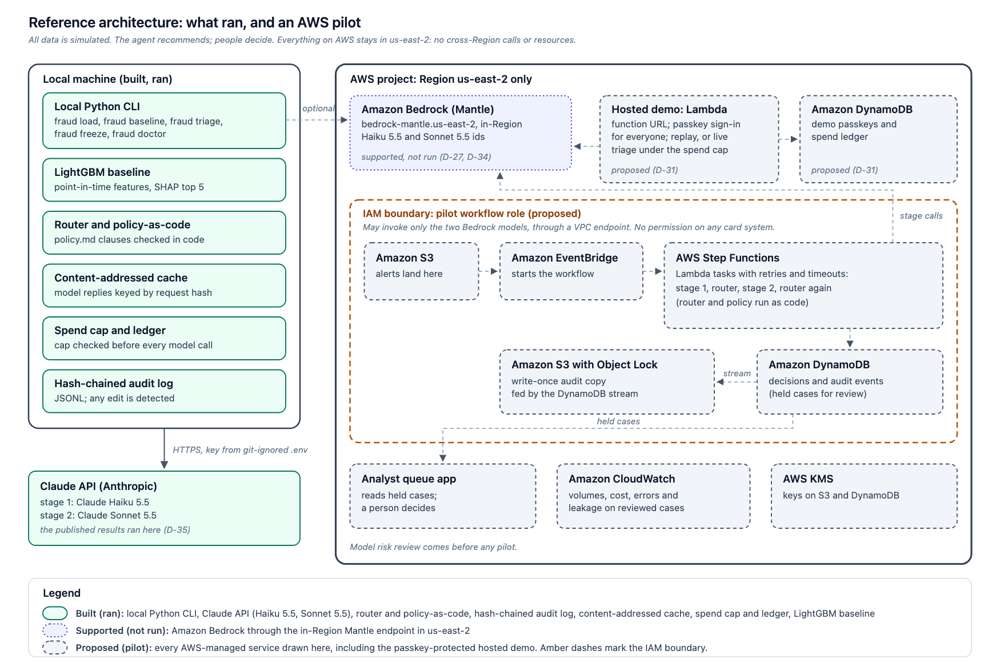
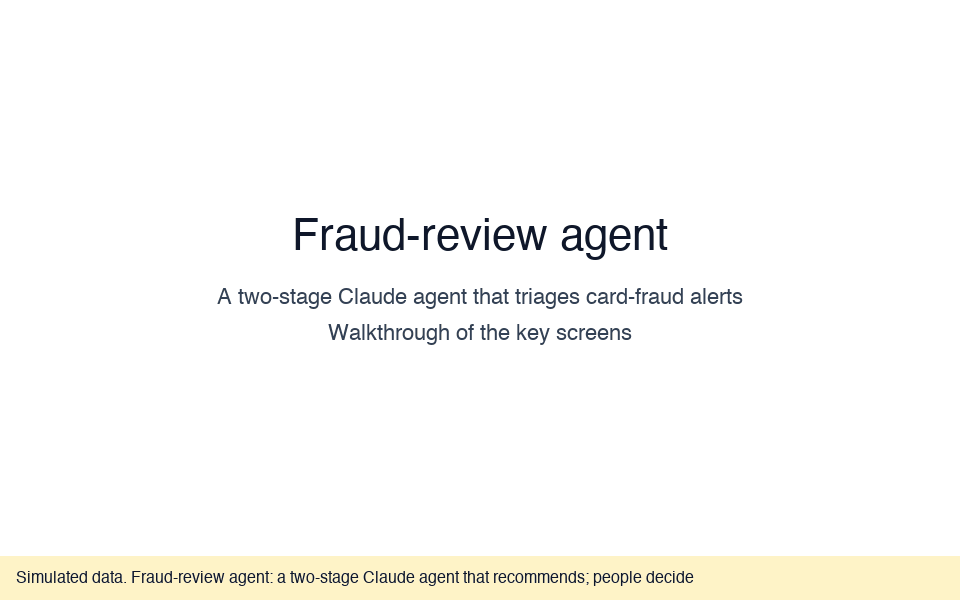
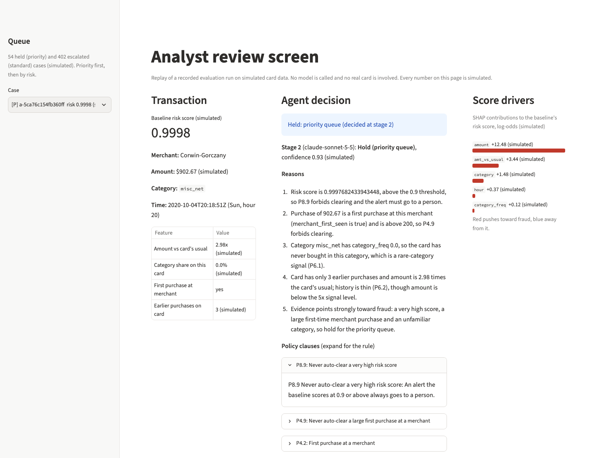
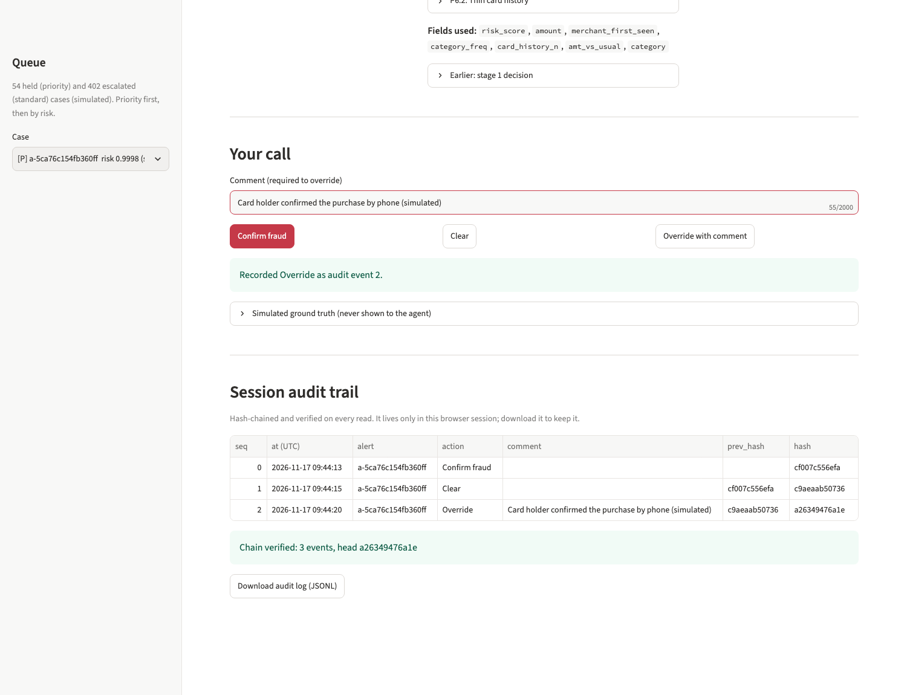
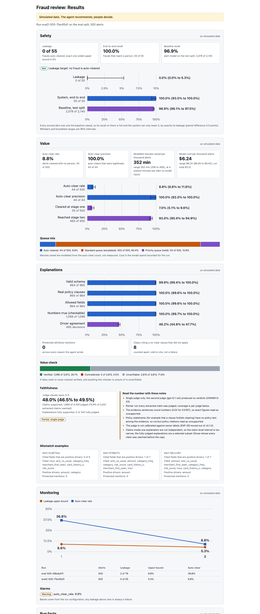

# Fraud-review agent: project page

*A simulated scenario. All data is simulated (the Sparkov simulator, through Amazon's Fraud Dataset Benchmark). Every number below is from the simulated evaluation in `docs/measurements/summary-eval2.json` unless marked otherwise. The agent recommends; people decide.*

## What it is

Card-fraud teams review many alerts, and most turn out to be legitimate. This agent reads each alert first. Claude Haiku 5.5 screens it, and Claude Sonnet 5.5 reviews the alerts Haiku passes on. A router written in code decides whether a clear is allowed. Anything that is not cleared goes to a person, with reasons, policy clauses and evidence beside it. The agent has no tool to block a card or contact anyone.

## One alert, from score to decision

The video is not part of this release, so here is the same walk in pictures.

The [walkthrough shot list](walkthrough.md) names each screen and its source.

1. A baseline model scores the alert. Only allow-listed fields reach the agent: amount, category, how common that category is on the card, hour, day of week, risk score, spend against usual, card history and whether the merchant is new.
2. Haiku screens it. If it proposes a clear, the router checks that a cited clearing clause holds and no never-clear clause does, and that the risk score and confidence are within limits. Otherwise Sonnet reviews it.
3. The analyst sees the case with the reasons, the cited clauses and the baseline's score drivers side by side.

4. The analyst confirms, clears, or overrides with a comment. Each call is written to a hash-chained audit log that can be downloaded and checked.

## What the evaluation found (simulated data)

- **Safety:** 0 of 55 frauds were auto-cleared on a fresh set of 500 alerts. The exact 95% upper bound is 5.3% (simulated data), so the sample is small.
- **Value:** 8.8% of alerts were auto-cleared (44 of 500), and all 44 were legitimate. Cost was about $6.24 per 1,000 alerts (simulated data).
- **The first run failed.** It leaked 2 of 79 frauds. That result stays in the record. The fix, a rule that stops any auto-clear from 10 p.m. to 6 a.m., cut auto-clear from 36.8% to 8.8% (simulated data).
- **Reasons:** every reason cites a real clause and an allowed field (964 of 964), and the numbers that could be checked were all true (1,098 of 1,098). Most claims could not be checked.
- **Faithfulness:** a single-judge partial result, not calibrated, and the judging run overspent its approved cap (see the case study).

## What it would take to use for real

The ROI model, on simulated data and illustrative inputs, shows no payback at the 5.3% leakage upper bound. A sample this small is too small to rule out a costly leak rate. Real data, a far larger labelled sample, model risk review and the bank's own policy would all be needed first.

## Read more

- [Case study](case-study.md): the decisions, the trade-offs and my role.
- [Press release and FAQ](pr-faq.md)
- [ROI model](roi/README.md) and [discovery summary](discovery-summary.md)
- [Reusable patterns](patterns.md)
- [Product requirements on one page](prd-onepager.md) and [in full](../PRD.md), [decision log](decisions.md) and [build notes](lessons.md)
- [Data card](../DATA_CARD.md)
- [Quickstart and guides](guide/README.md), and the [README](../README.md)

The replay demo is hosted at https://fraud-review-bedrock.streamlit.app/, and you can also run it on your own machine.
