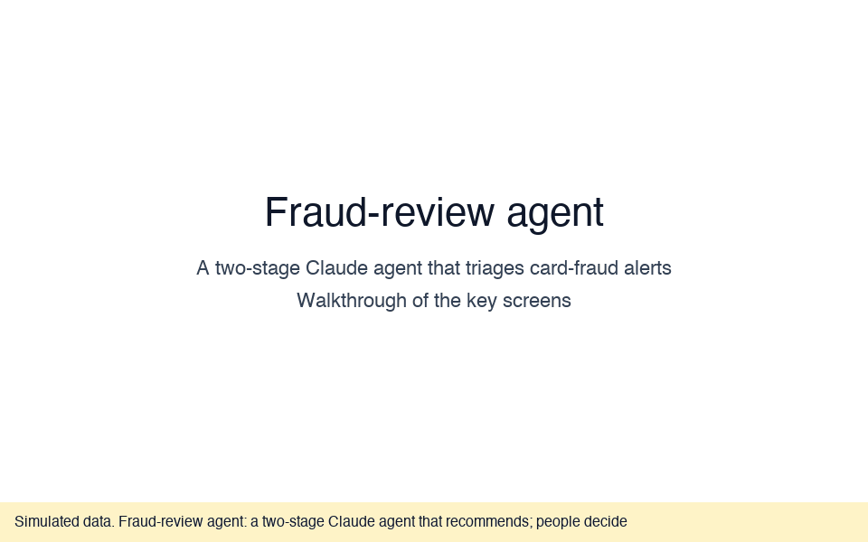

# Walkthrough

*Simulated data. A looping walkthrough of the key screens stands in for a video: [`assets/walkthrough.gif`](assets/walkthrough.gif). It has nine frames at 2.5 seconds each, is 960 pixels wide, and shows no keys and no spend. It is built from screenshots in this repo by `scripts/build_walkthrough.py`.*

## Shot list

| # | Screen | Source |
| --- | --- | --- |
| 1 | Title card | Drawn by the script |
| 2 | Architecture: the model recommends and a router in code decides | `docs/assets/architecture.png` |
| 3 | Analyst review screen: reasons, policy clauses and score drivers | `docs/assets/screens/review-case.png` |
| 4 | Audit log: every decision is hash-chained and downloadable | `docs/assets/screens/review-audit.png` |
| 5 | Safety panel: leakage and recall | `docs/assets/screens/dashboard.png` (crop) |
| 6 | Value panel: auto-clear rate and queue mix (the cost tiles are left out) | `docs/assets/screens/dashboard.png` (crop) |
| 7 | Explanation checks: clauses, fields, numbers | `docs/assets/screens/dashboard.png` (crop) |
| 8 | Faithfulness: a single-judge partial result with its caveats | `docs/assets/screens/dashboard.png` (crop) |
| 9 | Monitoring trend: the first run failed and stays in the record | `docs/assets/screens/dashboard.png` (crop) |

To rebuild it, run `uv run python scripts/build_walkthrough.py`.
